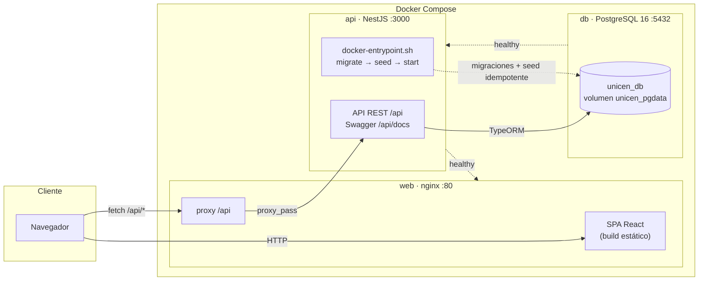
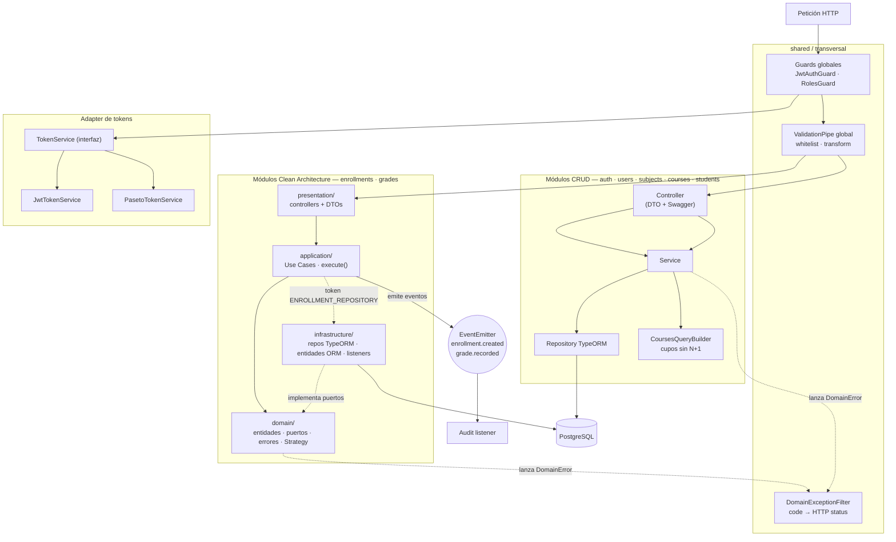
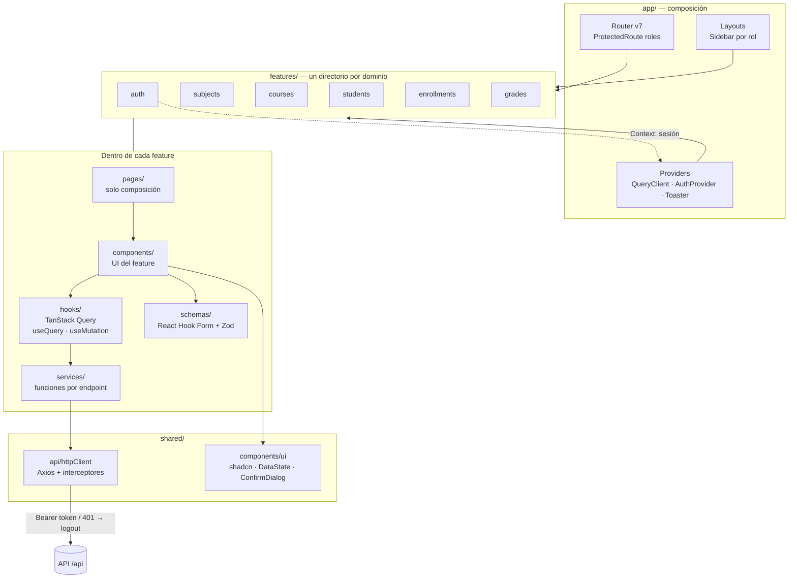
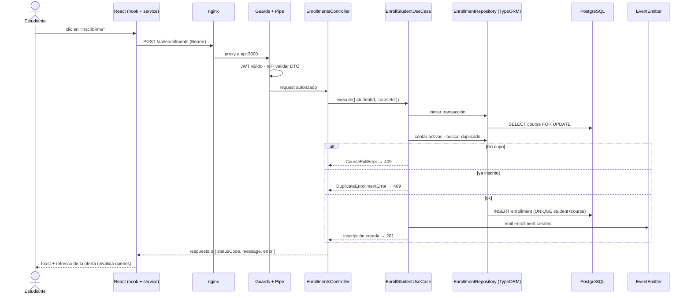
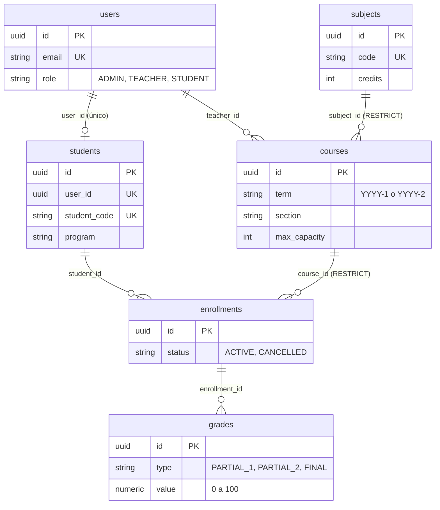

# UNICEN — Sistema Académico

Prueba técnica: sistema académico para gestionar **materias, cursos, estudiantes, inscripciones y notas**, con autenticación y autorización por rol.

- **Backend** (`unicen_backend`): API REST con NestJS 11 + PostgreSQL 16 + TypeORM.
- **Frontend** (`unicen_frontend`): SPA con Vite + React 19 + TypeScript.
- **Orquestación**: Docker Compose (`db` + `api` + `web`), con migraciones y seed automáticos.

> Para el evaluador: todo se levanta con **un solo comando** (`npm start`, ver [Cómo correrlo](#cómo-correrlo-docker)) y las credenciales de prueba están en [Seed](#credenciales-de-prueba).

## Índice

1. [Cómo correrlo (Docker)](#cómo-correrlo-docker)
2. [Seed (datos de ejemplo)](#seed-datos-de-ejemplo)
3. [Funcionalidad del sistema](#funcionalidad-del-sistema)
4. [Arquitectura](#arquitectura)
5. [Decisiones de arquitectura y patrones](#decisiones-de-arquitectura-y-patrones)
6. [Diagramas de arquitectura](#diagramas-de-arquitectura)
7. [Modelo de datos](#modelo-de-datos)
8. [API](#api)
9. [Testing y calidad](#testing-y-calidad)
10. [Estado de avance](#estado-de-avance)
11. [Estructura del repositorio](#estructura-del-repositorio)
12. [Desarrollo sin Docker](#desarrollo-sin-docker)

---

## Cómo correrlo (Docker)

Requisitos: Docker con Compose v2 (y Node/npm solo para usar los atajos `npm`).

```bash
npm start
# equivalente: docker compose up --build
```

Levanta tres servicios, sin pasos manuales:

| Servicio | Contenedor | Qué hace | URL |
|---|---|---|---|
| `db` | `unicen-postgres` | PostgreSQL 16 (volumen `unicen_pgdata`) | `localhost:5433` |
| `api` | `unicen-api` | Backend: migraciones + seed + API | http://localhost:3000/api · Swagger: http://localhost:3000/api/docs |
| `web` | `unicen-web` | Frontend (nginx) con proxy de `/api` hacia `api` | http://localhost |

Orden de arranque: `db` (healthcheck `pg_isready`) → `api` (healthcheck, queda sana solo tras migrar y sembrar) → `web`.

### Comandos de la raíz

| Comando | Equivalente | Uso |
|---|---|---|
| `npm start` | `docker compose up --build` | Construye y levanta todo en primer plano |
| `npm run start:detached` | `docker compose up --build -d` | Igual, en segundo plano |
| `npm run stop` | `docker compose down` | Detiene y quita contenedores (conserva la base) |
| `npm run reset` | `docker compose down -v && docker compose up --build` | Borra la base y vuelve a empezar desde cero |
| `npm run logs` | `docker compose logs -f` | Sigue los logs |
| `npm run ps` | `docker compose ps` | Estado de los servicios |
| `npm run seed` | `docker compose exec api node dist/database/seeds/seed.js` | Re-ejecuta el seed sobre la API en marcha |

### Si algo falla al levantar

- **Puerto ocupado** (80, 3000 o 5433): define otro en un `.env` en la raíz, por ejemplo `WEB_PORT=8080`, `API_PORT=3001`, `DB_HOST_PORT=5434`, y vuelve a correr `npm start`.
- **Datos viejos o inconsistentes**: `npm run reset` borra el volumen y rehace migraciones y seed desde cero.
- **Primer arranque**: construir las imágenes tarda unos minutos; `web` aparece solo cuando `api` terminó de migrar y sembrar. Verifica con `npm run ps` (los tres servicios en `healthy`/`Up`).

### Variables opcionales

Se leen del entorno o de un `.env` en la raíz; todas tienen valor por defecto:
`DB_USER`, `DB_PASSWORD`, `DB_NAME`, `DB_HOST_PORT` (5433), `API_PORT` (3000), `WEB_PORT` (80), `TOKEN_PROVIDER` (`jwt` | `paseto`), `JWT_SECRET`, `JWT_EXPIRES_IN` (8h).

---

## Seed (datos de ejemplo)

### Automático

Cada vez que arranca el contenedor `api`, `unicen_backend/docker-entrypoint.sh` ejecuta en orden:

1. `migration:run` — aplica las migraciones pendientes.
2. `seed.js` — carga usuarios, perfiles de estudiante, materias, cursos e inscripciones de ejemplo.
3. `node dist/main` — inicia la API.

El seed es **idempotente**: cada paso omite lo que ya existe, así que reiniciar no duplica datos.

### Manual

Con el stack arriba, para volver a sembrar:

```bash
npm run seed
```

Para empezar con la base vacía y re-sembrada: `npm run reset`.

### Dónde se define

`unicen_backend/src/database/seeds/`: `seed.ts` (orquestador, respeta el orden de dependencias), `users.seed.ts`, `students.seed.ts`, `subjects.seed.ts`, `courses.seed.ts`, `enrollments.seed.ts`. Todo seed nuevo debe ser idempotente y registrarse en `seed.ts`.

### Credenciales de prueba

| Rol | Email | Contraseña |
|---|---|---|
| `ADMIN` | `admin@unicen.edu.bo` | `Admin123!` |
| `TEACHER` | `docente@unicen.edu.bo` | `Teacher123!` |
| `TEACHER` | `docente2@unicen.edu.bo` | `Teacher123!` |
| `STUDENT` | `estudiante@unicen.edu.bo` | `Student123!` |
| `STUDENT` | `estudiante2@unicen.edu.bo` | `Student123!` |
| `STUDENT` | `estudiante3@unicen.edu.bo` | `Student123!` |

### Qué datos deja el seed

**6 usuarios** (los de arriba), **3 perfiles de estudiante**, **5 materias**, **6 cursos** y **4 inscripciones**:

| Materia | Gestión | Paralelo | Cupo | Docente | Inscritos |
|---|---|---|---|---|---|
| MAT-101 Cálculo I | 2026-2 | A | 30 | `docente` | 1 (`estudiante`) |
| MAT-101 Cálculo I | 2026-2 | B | 25 | `docente2` | 0 |
| BDD-201 Base de Datos I | 2026-2 | A | 20 | `docente` | 1 (`estudiante`) |
| FIS-101 Física I | 2026-1 | A | 30 | `docente` | 1 (`estudiante`) |
| PRG-101 Programación I | 2026-2 | A | **2** | `docente` | 1 (`estudiante2`) |
| SIS-301 Ingeniería de Software | 2026-2 | A | 15 | `docente2` | 0 |

`PRG-101 A` queda con **un solo cupo libre** a propósito: sirve para demostrar la regla de cupo y la concurrencia (si dos estudiantes compiten por el último lugar, el segundo recibe `409`).

Recorrido rápido sugerido: entrar como `estudiante` → *Oferta de cursos* → inscribirse en `SIS-301`; luego como `admin` inscribir a `estudiante3` en `PRG-101 A` (toma el último cupo) y probar con `estudiante` para ver el `409` por cupo lleno.

---

## Funcionalidad del sistema

Tres roles con permisos distintos. El desglose completo en historias de usuario y criterios de aceptación está en [`docs/tasks.md`](docs/tasks.md).

| Rol | Puede hacer |
|---|---|
| `ADMIN` | Gestionar usuarios, materias, oferta de cursos y estudiantes; inscribir a cualquier estudiante; ver el historial de cualquiera. |
| `TEACHER` | Ver los cursos que dicta y sus inscritos; registrar y editar las notas de sus cursos (solo los suyos). |
| `STUDENT` | Ver la oferta de cursos con cupos disponibles; inscribirse y cancelar; ver sus inscripciones y su historial académico con la nota final calculada. |

### Reglas de negocio principales

- **Inscripción** (HU-10): el curso debe existir, tener cupo (`inscripciones activas < maxCapacity`) y el estudiante no puede estar ya inscrito. Se ejecuta en una **transacción con `SELECT ... FOR UPDATE`** sobre el curso, de modo que dos solicitudes simultáneas al último cupo no generan sobrecupo. La restricción `UNIQUE (student_id, course_id)` es el respaldo en base de datos.
- **Notas** (HU-14): valor de 0 a 100; solo el docente asignado al curso puede registrarlas; una nota por tipo (`PARTIAL_1`, `PARTIAL_2`, `FINAL`, ponderadas 30/30/40) y por inscripción; no se registran en inscripciones canceladas.
- **Historial** (HU-16): el estudiante ve solo el suyo; el ADMIN puede ver cualquiera. La nota final se calcula con una estrategia (promedio ponderado por defecto); aprobado con ≥ 51.
- **Cursos** (HU-06): la combinación `(materia, gestión, paralelo)` es única; el docente asignado debe tener rol `TEACHER`; no se puede reducir el cupo por debajo de los inscritos.
- **Integridad al borrar**: no se elimina una materia con cursos ni un curso con inscripciones (`409`).
- **Errores uniformes** `{ statusCode, message, error }` con `409` para conflictos (cupo lleno, duplicado), `403` para acciones no permitidas y `404` para recursos inexistentes.

---

## Arquitectura

Ver [Diagramas de arquitectura](#diagramas-de-arquitectura) para el detalle visual.

**Un único origen para el navegador:** nginx sirve la SPA y reenvía `/api` al backend, por lo que no se depende de CORS en producción.

### Backend — modular + Clean Architecture pragmática

```
src/
├── config/        # validación de env (Joi), TypeORM, data-source (CLI)
├── database/      # migrations/, seeds/
├── shared/        # guards, decorators, filters, errors, enums
└── modules/
    ├── auth/  users/  subjects/  courses/  students/   # CRUD: controller → service → repository
    └── enrollments/  grades/                          # Clean Architecture completa
```

Los módulos con reglas de negocio se dividen en cuatro capas con dependencias hacia adentro:

```
<module>/
├── domain/          # entidades, puertos (interfaces de repositorio), errores de dominio, strategies
├── application/     # casos de uso (una clase, un método execute())
├── infrastructure/  # repositorios TypeORM (adaptadores), entidades ORM, listeners
└── presentation/    # controllers y DTOs
```

`domain/` no importa NestJS ni TypeORM. Los controllers son delgados: validan el DTO y delegan.

### Frontend — SPA por features (Screaming Architecture)

```
src/
├── app/        # router, providers, layouts
├── features/   # auth, subjects, courses, students, enrollments, grades
└── shared/     # api (httpClient), components/ui (shadcn), hooks, utils
```

Flujo de datos por capas: **Componente → Hook → Service → `httpClient`**. TanStack Query maneja el estado del servidor; Context solo guarda la sesión.

---

## Decisiones de arquitectura y patrones

El registro completo (formato ADR liviano: contexto → decisión → justificación → consecuencias) está en:

- 📄 **Backend:** [`unicen_backend/docs/decisions.md`](unicen_backend/docs/decisions.md) — BD-001 a BD-019
- 📄 **Frontend:** [`unicen_frontend/docs/decisions.md`](unicen_frontend/docs/decisions.md) — FD-001 a FD-015

A continuación, las más relevantes y por qué.

### Patrones de diseño elegidos

| Patrón | Dónde | Justificación |
|---|---|---|
| **Repository** (BD-003) | `enrollments`, `grades`: el dominio define el puerto, `infrastructure/` lo implementa con TypeORM y se inyecta por token (`ENROLLMENT_REPOSITORY`). | Aísla las reglas de negocio de la persistencia y permite probar los casos de uso con repositorios simulados. |
| **Strategy** (BD-006) | `GradeCalculationStrategy`: promedio ponderado (defecto) y promedio simple. | El cálculo de la nota final puede variar por reglamento o materia; se agregan estrategias sin tocar el caso de uso (abierto/cerrado). |
| **Observer** (BD-007) | Eventos `enrollment.created` y `grade.recorded` con `@nestjs/event-emitter`, escuchados por un listener de auditoría. | Los efectos secundarios (auditoría, futuras notificaciones) quedan desacoplados del flujo principal y de otros módulos. |
| **Adapter / Factory** (BD-008) | Interfaz `TokenService` con `JwtTokenService` y `PasetoTokenService`; un factory elige según `TOKEN_PROVIDER`. | El enunciado menciona "passeto jwt"; ante la ambigüedad se soportan ambos y se cambia por configuración sin tocar casos de uso ni guards. |
| **Use Case** (BD-004) | Una clase por operación de negocio (`EnrollStudentUseCase`, `RecordGradeUseCase`, `GetAcademicHistoryUseCase`) con un único `execute()`. | Responsabilidad única, nombres que expresan la intención del negocio y tests focalizados. |

### Decisiones clave del backend

- **Clean Architecture solo donde aporta (BD-002).** Los módulos CRUD (`subjects`, `courses`, `students`, `users`) usan capas simples; `enrollments` y `grades`, donde viven las reglas críticas, usan Clean Architecture completa. Evita la sobreingeniería sin sacrificar testabilidad donde importa.
- **Concurrencia en la inscripción (BD-005).** Transacción + `SELECT ... FOR UPDATE` sobre el curso + `UNIQUE (student_id, course_id)` como red de seguridad: la consistencia la garantiza la base de datos, no validaciones en memoria.
- **Migraciones con `synchronize: false` (BD-010).** Esquema reproducible y auditable; claves UUID, timestamps y snake_case. El seed deja el entorno listo para evaluar.
- **Autorización en dos niveles (BD-009).** Guards globales (`JwtAuthGuard`, `RolesGuard` + `@Roles`) resuelven el acceso por rol; la *propiedad del recurso* (el docente del curso, el estudiante dueño del historial) es regla de negocio y se valida en los casos de uso.
- **Errores de dominio desacoplados de HTTP (BD-011, BD-019).** Los errores extienden `DomainError` y un filtro global los mapea a HTTP con un mapa `code → status`; el dominio no conoce HTTP.
- **Integridad referencial en la base (BD-016).** `ON DELETE RESTRICT` y traducción del error `23503` a `409`, correcto incluso bajo concurrencia y sin dependencias circulares entre módulos.
- **Lecturas sin N+1 (BD-017).** `enrolledCount`, `availableSeats` e `isEnrolled` se calculan con subconsultas en un solo query.
- **La inscripción pertenece al perfil académico (BD-018).** `enrollments.student_id` apunta a `students.id` (no a la cuenta); `students.user_id` enlaza con `users`.
- **Validación y contrato (BD-012).** `ValidationPipe` global (`whitelist`, `forbidNonWhitelisted`, `transform`), DTOs con `class-validator`, Swagger en `/api/docs`; nunca se expone `password_hash`.

### Decisiones clave del frontend

- **SPA con Vite + React en lugar de Next.js (FD-001).** Hay un backend independiente y la app es interna, sin SEO ni SSR; Next.js duplicaría responsabilidades. El build estático se sirve con nginx (imagen liviana).
- **Arquitectura por features (FD-002)** y **flujo por capas Componente → Hook → Service → httpClient (FD-003):** la estructura comunica el dominio y las llamadas HTTP no se dispersan en los componentes.
- **TanStack Query para el estado del servidor; Context solo para auth (FD-004).** Cache, estados de carga/error e invalidación vienen incluidos; no hace falta Redux ni Zustand.
- **Un solo `httpClient` con interceptores (FD-005):** inyecta el token Bearer y cierra la sesión ante un `401`.
- **React Hook Form + Zod (FD-006, FD-015):** validación tipada de la *forma* de los datos; las reglas de negocio (cupo, duplicados) las valida el backend y se muestran con toasts.
- **Tailwind v4 + shadcn/ui (FD-007):** componentes accesibles cuyo código vive en el repo.
- **Rutas por rol en el cliente (FD-008):** `<ProtectedRoute roles>` redirige a `/login` o `/403`; es solo UX, la autorización real la aplican los guards de la API.
- **Estados de carga/vacío/error estandarizados (FD-013, FD-014)** y **filtro de gestión en la URL `?term=` (FD-012):** vistas compartibles y consistentes.
- **Sin herramientas de monorepo; Docker Compose como orquestador (FD-010).** Son dos apps independientes que hablan por HTTP; Turborepo/Nx no aportarían valor.

### Convenciones (BD-014, FD-009)

Reglas por módulo en [`unicen_backend/AGENTS.md`](unicen_backend/AGENTS.md) y [`unicen_frontend/AGENTS.md`](unicen_frontend/AGENTS.md): código en inglés, JSDoc obligatorio, archivos ≤ 600 líneas, nombres explícitos y Conventional Commits.

---

## Diagramas de arquitectura

Cuatro vistas, de lo general a lo particular: sistema completo, backend, frontend y flujo de una petición. El modelo de datos va a continuación.

### 1. Vista general del sistema (despliegue)



### 2. Backend — módulos y capas



Reglas de dependencia: `domain/` no importa NestJS ni TypeORM; los controllers no tienen lógica de negocio; los módulos se comunican por proveedores exportados o eventos, nunca por el repositorio de otro módulo.

### 3. Frontend — features y flujo de datos



Reglas: un feature no importa los internos de otro (lo reutilizable sube a `shared/`); Context solo para la sesión; el estado del servidor vive en TanStack Query.

### 4. Flujo de una petición: inscribirse a un curso (HU-10)



## Modelo de datos



Restricciones destacadas: `UNIQUE (subject_id, term, section)` en `courses`, `UNIQUE (student_id, course_id)` en `enrollments`, y una nota por tipo y por inscripción.

---

## API

Prefijo global `/api`. Documentación interactiva y esquemas en **Swagger: `/api/docs`**. Toda ruta requiere token Bearer salvo `POST /auth/login`.

| Área | Endpoints |
|---|---|
| Auth | `POST /auth/login` · `GET /auth/me` |
| Usuarios | `POST /users` · `GET /users` (ADMIN) |
| Materias | `GET/POST /subjects` · `GET/PATCH/DELETE /subjects/:id` |
| Cursos | `GET /courses?term=` · `GET /courses/mine` · `GET /courses/:id` · `GET /courses/:id/enrolled-students` · `POST /courses` · `PATCH/DELETE /courses/:id` |
| Estudiantes | `/students` (E3) · `GET /students/:id/history` (E4) |
| Inscripciones | `POST /enrollments` · `GET /enrollments/mine` · cancelación (E3) |
| Notas | `POST /grades` · `PATCH /grades/:id` (E4) |

Ejemplo:

```bash
curl -X POST http://localhost/api/auth/login \
  -H 'content-type: application/json' \
  -d '{"email":"admin@unicen.edu.bo","password":"Admin123!"}'
```

---

## Testing y calidad

- **Unitarios (Jest):** obligatorios para casos de uso y estrategias, con repositorios simulados a partir de sus interfaces; cubren el camino feliz y cada error de dominio (curso lleno, duplicado, acción prohibida, valor fuera de rango).
- **E2E (Supertest):** `unicen_backend/test/*.e2e-spec.ts` sobre la base del seed (login, cursos; inscripción y notas por rol en E3/E4).
- **Antes de cerrar una tarea:** `npm run lint`, `npm run build` y `npm test` en el backend; `npm run lint` y `npm run build` en el frontend.
- **Commits:** Conventional Commits por historia (`feat(courses): HU-08 teacher courses and enrolled students`).

```bash
cd unicen_backend && npm test && npm run test:e2e
```

---

## Estado de avance

| Épica | Alcance | Estado |
|---|---|---|
| E0 | Docker Compose, migraciones, seed, Swagger | ✅ |
| E1 | Autenticación y roles (JWT/PASETO) | ✅ |
| E2 | Materias y cursos (HU-05 a HU-08) | ✅ |
| E3 | Estudiantes e inscripciones (HU-09 a HU-13) | ✅ |
| E4 | Notas e historial académico (HU-14 a HU-18) | ⏳ módulos esqueleto creados |

Los planes de cada épica (backend, frontend e integración) están en [`docs/plans/`](docs/plans). Este README se actualiza al cerrar cada épica.

---

## Estructura del repositorio

```
.
├── docker-compose.yml        # db + api + web
├── package.json              # atajos: npm start / stop / reset / seed / logs
├── docs/
│   ├── tasks.md              # historias de usuario y criterios de aceptación
│   └── plans/                # planes por épica (E1–E3)
├── unicen_backend/           # NestJS · AGENTS.md · docs/decisions.md · Dockerfile
└── unicen_frontend/          # React + Vite · AGENTS.md · docs/decisions.md · Dockerfile + nginx.conf
```

---

## Desarrollo sin Docker

- Base de datos: `docker compose up db -d` (puerto 5433 en el host; ajusta `DB_PORT` en `unicen_backend/.env`, ver `.env.example`).
- Backend: `cd unicen_backend && npm run migration:run && npm run seed && npm run start:dev`.
- Frontend: `cd unicen_frontend && npm run dev` (usa `VITE_API_URL` de `unicen_frontend/.env`).
