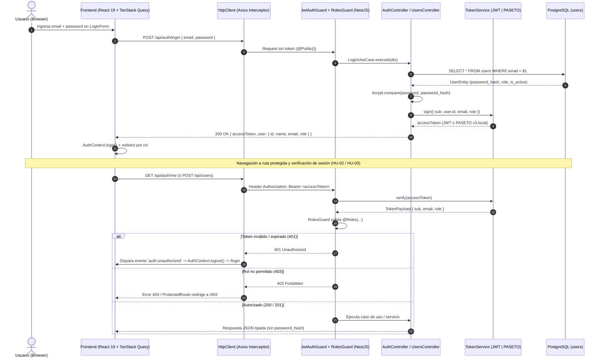

# Plan Maestro de Integración (Backend + Frontend) — Épica E1: Autenticación y Roles

## 1. Documentos del Plan E1
Este plan maestro coordina e integra la implementación de extremo a extremo de la **Épica E1 — Autenticación y roles** entre ambos módulos del monorepo:

1. **Plan Backend:** [docs/plans/e1-backend-auth-plan.md](file:///c:/Users/LOQ/Documents/JOBS/UNICEN_TEST/docs/plans/e1-backend-auth-plan.md) — Regido por [unicen_backend/AGENTS.md](file:///c:/Users/LOQ/Documents/JOBS/UNICEN_TEST/unicen_backend/AGENTS.md).
2. **Plan Frontend:** [docs/plans/e1-frontend-auth-plan.md](file:///c:/Users/LOQ/Documents/JOBS/UNICEN_TEST/docs/plans/e1-frontend-auth-plan.md) — Regido por [unicen_frontend/AGENTS.md](file:///c:/Users/LOQ/Documents/JOBS/UNICEN_TEST/unicen_frontend/AGENTS.md) y [unicen_frontend/DESIGN.md](file:///c:/Users/LOQ/Documents/JOBS/UNICEN_TEST/unicen_frontend/DESIGN.md).

---

## 2. Flujo End-to-End de Autenticación y Autorización



---

## 3. Contratos de Integración HTTP (API ↔ Frontend)

Todos los endpoints usan el prefijo global `/api` y devuelven errores con el formato uniforme `{ statusCode, message, error }`.

### 3.1. `POST /api/auth/login` (HU-01 · `@Public()`)
- **Request Body (`LoginDto` / `LoginRequest`):**
  ```json
  {
    "email": "admin@unicen.edu.bo",
    "password": "Admin123!"
  }
  ```
- **Response `200 OK` (`LoginResponseDto` / `LoginResponse`):**
  ```json
  {
    "accessToken": "eyJhbGciOiJIUzI1NiIs...",
    "user": {
      "id": "550e8400-e29b-41d4-a716-446655440000",
      "name": "Administrador UNICEN",
      "email": "admin@unicen.edu.bo",
      "role": "ADMIN"
    }
  }
  ```
- **Response `401 Unauthorized` (`InvalidCredentialsError`):**
  ```json
  {
    "statusCode": 401,
    "error": "INVALID_CREDENTIALS",
    "message": "Credenciales inválidas"
  }
  ```

### 3.2. `GET /api/auth/me` (HU-03 · Bearer Token requerido)
- **Response `200 OK` (`AuthUserDto` / `AuthUser`):**
  ```json
  {
    "id": "550e8400-e29b-41d4-a716-446655440000",
    "name": "Administrador UNICEN",
    "email": "admin@unicen.edu.bo",
    "role": "ADMIN"
  }
  ```
- **Response `401 Unauthorized`:** Cuando no se envía token, está vencido o el usuario fue desactivado.

### 3.3. `POST /api/users` (HU-04 · `@Roles(Role.ADMIN)`)
- **Request Body (`CreateUserDto` / `CreateUserRequest`):**
  ```json
  {
    "name": "Ing. Roberto Paz",
    "email": "roberto.paz@unicen.edu.bo",
    "password": "Teacher123!",
    "role": "TEACHER"
  }
  ```
- **Response `201 Created` (`UserResponseDto` / `AuthUser`):**
  ```json
  {
    "id": "7c9e6679-7425-40de-944b-e07fc1f90ae7",
    "name": "Ing. Roberto Paz",
    "email": "roberto.paz@unicen.edu.bo",
    "role": "TEACHER",
    "isActive": true,
    "createdAt": "2026-10-27T14:00:00.000Z"
  }
  ```
- **Response `409 Conflict` (`DuplicateUserEmailError`):**
  ```json
  {
    "statusCode": 409,
    "error": "DUPLICATE_USER_EMAIL",
    "message": "El correo electrónico ya se encuentra registrado"
  }
  ```

### 3.4. `GET /api/users?role=TEACHER` (HU-04 · `@Roles(Role.ADMIN)`)
- **Response `200 OK`:** `UserResponseDto[]` (sin `passwordHash`).

---

## 4. Matriz de Roles, Rutas y Permisos (HU-02)

| Funcionalidad / Recurso | Ruta API (Backend) | Ruta SPA (Frontend) | `ADMIN` | `TEACHER` | `STUDENT` |
|---|---|---|---|---|---|
| Iniciar sesión | `POST /api/auth/login` | `/login` | Público | Público | Público |
| Perfil actual | `GET /api/auth/me` | *(Sidebar / Header)* | ✅ | ✅ | ✅ |
| Gestión de usuarios | `GET/POST /api/users` | `/users` | ✅ | ❌ (`403`) | ❌ (`403`) |
| Catálogo de materias | `/api/subjects` | `/subjects` | ✅ *(Inicio)* | ✅ | ✅ |
| Oferta / Mis cursos | `/api/courses` | `/courses` | ✅ | ✅ *(Inicio)* | ✅ *(Inicio)* |
| Registro de estudiantes | `/api/students` | `/students` | ✅ | ❌ (`403`) | ❌ (`403`) |
| Inscripciones | `/api/enrollments` | `/enrollments` | ✅ | ❌ (`403`) | ✅ |
| Historial académico | `/api/grades/history` | `/grades/history` | ✅ *(por ID)* | ❌ (`403`) | ✅ *(propio)* |

---

## 5. Orden de Ejecución Paso a Paso

### Fase 1: Dominio, Entidad y Persistencia de Usuarios (Backend)
1. Actualizar `env.validation.ts` y `.env.example` con `TOKEN_PROVIDER` (`jwt` | `paseto`) y `JWT_EXPIRES_IN=8h`.
2. Agregar `InvalidCredentialsError` y `DuplicateUserEmailError` en `domain.errors.ts` y su mapeo `401`/`409` en `domain-exception.filter.ts`.
3. Completar `UserEntity` (`users` table), `CreateUserDto`, `UserResponseDto`, `UsersService` y `UsersController` (`POST /api/users`, `GET /api/users`).
4. Crear la migración de la tabla `users` y actualizar `seed.ts` con los usuarios de prueba (`ADMIN`, `TEACHER`, `STUDENT`).

### Fase 2: Autenticación, Tokens (JWT + PASETO) y Guards (Backend)
5. Implementar `PasetoTokenService` (HU-19) junto a `JwtTokenService` y configurar el factory provider `TOKEN_SERVICE` en `AuthModule`.
6. Actualizar `JwtAuthGuard` (verificación vía `TOKEN_SERVICE`), `RolesGuard` y `@CurrentUser()`.
7. Implementar `LoginUseCase` (HU-01), `GetProfileUseCase` (HU-03) y los endpoints en `AuthController` (`POST /api/auth/login`, `GET /api/auth/me`).
8. Escribir y ejecutar los tests unitarios de `LoginUseCase`, `GetProfileUseCase`, `PasetoTokenService`, `JwtTokenService`, `UsersService` y Guards (`npm run lint && npm run build && npm test`).

### Fase 3: Normalización a Inglés y Sistema de Diseño UNICEN (Frontend)
9. Configurar la fuente `Outfit` y los tokens visuales de `DESIGN.md` (`navy`, `orange`, `surface-100`, `surface-200`, `navy-tint`) en `index.html` e `index.css`.
10. Reemplazar `Rol` por `Role` (`ADMIN`, `TEACHER`, `STUDENT`) en `src/shared/types/index.ts`, crear `error.utils.ts` y renombrar las carpetas de `src/features/` a inglés (`subjects`, `courses`, `students`, `enrollments`, `grades`).

### Fase 4: Flujo de Autenticación, Rutas por Rol y Gestión de Usuarios (Frontend)
11. Crear `types.ts`, `login.schema.ts`, `user.schema.ts`, `auth.service.ts`, `users.service.ts` y `role-navigation.utils.ts` dentro de `src/features/auth/`.
12. Actualizar `AuthContext.tsx` y crear los hooks `useLogin`, `useCurrentUser`, `useUsers` y `useCreateUser`.
13. Actualizar `ProtectedRoute.tsx` (redirección a `/login` y `/403`), crear `ForbiddenPage.tsx` (`/403`), `LoginPage.tsx` (`LoginForm` + `DemoCredentialsCard`), `DashboardLayout.tsx` (sidebar por rol + perfil + logout) y `UsersPage.tsx` (`UserTable` + `CreateUserDialog`).
14. Configurar `router.tsx` y verificar `npm run lint` y `npm run build` en `unicen_frontend`.

### Fase 5: Registro de Decisiones Técnicas y Commits
15. Registrar en `unicen_backend/docs/decisions.md` y `unicen_frontend/docs/decisions.md` la implementación del factory `TokenService` (JWT + PASETO) y la normalización a inglés + tokens UNICEN.
16. Realizar commits atómicos siguiendo Conventional Commits (`feat(auth): ...`, `feat(users): ...`).
