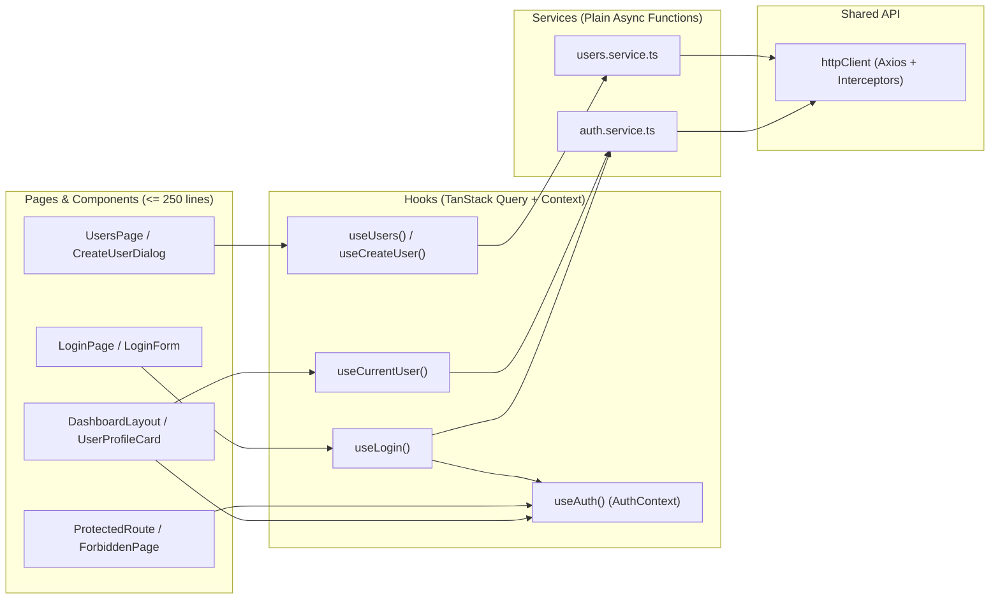

# Plan de Implementación Frontend — Épica E1: Autenticación, Roles, Sistema de Diseño y Usuarios

## 1. Objetivo y Alcance
Implementar la **Épica E1 (Autenticación y roles)** en `unicen_frontend` cumpliendo estrictamente con las reglas de [`unicen_frontend/AGENTS.md`](file:///c:/Users/LOQ/Documents/JOBS/UNICEN_TEST/unicen_frontend/AGENTS.md), las decisiones de [`unicen_frontend/docs/decisions.md`](file:///c:/Users/LOQ/Documents/JOBS/UNICEN_TEST/unicen_frontend/docs/decisions.md) y los fundamentos visuales de [`unicen_frontend/DESIGN.md`](file:///c:/Users/LOQ/Documents/JOBS/UNICEN_TEST/unicen_frontend/DESIGN.md).

### Objetivos Específicos
1. **Normalización del código a Inglés (`AGENTS.md`):**
   - Reemplazar `Rol` (`ADMIN`, `DOCENTE`, `ESTUDIANTE`) por el enum `Role` (`ADMIN`, `TEACHER`, `STUDENT`) en `src/shared/types/index.ts`.
   - Alinear los directorios de `src/features/` al estándar en inglés: `auth/`, `subjects/`, `courses/`, `students/`, `enrollments/`, `grades/`.
   - Alinear `AuthUser` al contrato de la API: `{ id: string; name: string; email: string; role: Role }`.
2. **Sistema de Diseño Institucional UNICEN (`DESIGN.md` & `design/tokens.json`):**
   - Configurar la fuente `Outfit` y los tokens de color (`navy: #01274b`, `orange: #ed6907`, `surface-100: #ffffff`, `surface-200: #f3f6fa`, `navy-tint: #e6ecf3`, `ink: #01274b`, `ink-muted: #4a5d74`, `border: #d5dde7`, `border-strong: #6b7f98`, `focus-ring: #ed6907`).
   - Aplicar el motivo del **punto naranja (`orange` dot)** en el ítem activo de navegación lateral y en la marca UNICEN.
3. **Flujo de Datos por Capas Obligatorio (`FD-003`):**
   - `Component → hook (TanStack Query) → service → httpClient → API`.
   - Ningún componente invoca `httpClient` directamente ni supera las **250 líneas**.
4. **Cobertura Completa de Historias E1:**
   - **HU-01 (🔴):** Pantalla de inicio de sesión (`LoginPage` + `LoginForm`) con React Hook Form + Zod, guardado de sesión y redirección automática al inicio según el rol.
   - **HU-02 (🔴):** `<ProtectedRoute roles={[...]}>` redirigiendo a `/login` sin sesión y a `/403` (`ForbiddenPage`) cuando el rol no tiene permiso; sidebar dinámico filtrado por rol.
   - **HU-03 (🔴):** Sincronización de perfil con `GET /api/auth/me` (`useCurrentUser`), visualización de datos del usuario en el layout, cierre de sesión manual y cierre automático ante respuestas `401`.
   - **HU-04 (🟡):** Gestión de usuarios para `Role.ADMIN` (`UsersPage`, `UserTable`, `CreateUserDialog`) consumiendo `GET /api/users` y `POST /api/users`.
   - **HU-19 (⚪):** Manejo opaco del `accessToken` en `httpClient` y `AuthContext`, compatible sin cambios tanto con tokens JWT como PASETO.

---

## 2. Arquitectura de Carpetas y Flujo de Datos (`unicen_frontend`)



### Estructura de Archivos en `src/features/auth/`
```text
src/features/auth/
├── components/
│   ├── CreateUserDialog.tsx      # Modal con formulario RHF + Zod para crear usuarios (HU-04)
│   ├── DemoCredentialsCard.tsx   # Acceso rápido / guía visual de credenciales de prueba por rol
│   ├── LoginForm.tsx             # Formulario de inicio de sesión con RHF + Zod (HU-01)
│   ├── ProtectedRoute.tsx        # Guard de rutas con redirección a /login o /403 (HU-02)
│   └── UserTable.tsx             # Tabla de usuarios registrados con badges de rol (HU-04)
├── context/
│   └── AuthContext.tsx           # Estado de sesión (user, token, login, logout, updateUser)
├── hooks/
│   ├── auth.keys.ts              # Query keys centralizadas: authKeys.me(), authKeys.users(role)
│   ├── useCreateUser.ts          # useMutation para POST /api/users + invalidación + toast
│   ├── useCurrentUser.ts         # useQuery para GET /api/auth/me (HU-03)
│   ├── useLogin.ts               # useMutation para POST /api/auth/login + redirección por rol
│   └── useUsers.ts               # useQuery para GET /api/users (HU-04)
├── pages/
│   ├── ForbiddenPage.tsx         # Pantalla /403 de acceso no autorizado (HU-02)
│   ├── LoginPage.tsx             # Página de login con identidad institucional UNICEN (HU-01)
│   └── UsersPage.tsx             # Página de administración de usuarios para ADMIN (HU-04)
├── schemas/
│   ├── login.schema.ts           # Esquema Zod para LoginForm
│   └── user.schema.ts            # Esquema Zod para CreateUserDialog
├── services/
│   ├── auth.service.ts           # login(), getMe()
│   └── users.service.ts          # getUsers(), createUser()
├── utils/
│   └── role-navigation.utils.ts  # getDefaultRouteByRole(role), ROLE_LABELS, ROLE_BADGE_STYLES
└── types.ts                      # AuthUser, LoginRequest, LoginResponse, CreateUserRequest
```

---

## 3. Cambios Propuestos por Componente

### 3.1. Sistema de Diseño y Tipos Compartidos (`src/index.css`, `src/shared/`)

#### [MODIFY] [index.html](file:///c:/Users/LOQ/Documents/JOBS/UNICEN_TEST/unicen_frontend/index.html) y [index.css](file:///c:/Users/LOQ/Documents/JOBS/UNICEN_TEST/unicen_frontend/src/index.css)
- Importar la tipografía **Outfit** (pesos 400, 600, 700) según `DESIGN.md`.
- Definir las variables CSS del sistema de diseño UNICEN (`--navy: #01274b`, `--orange: #ed6907`, `--surface-100: #ffffff`, `--surface-200: #f3f6fa`, `--navy-tint: #e6ecf3`, `--ink: #01274b`, `--ink-muted: #4a5d74`, `--accent-text: #b54d00`, `--border: #d5dde7`, `--border-strong: #6b7f98`, `--focus-ring: #ed6907`) y vincular `--primary` a `#01274b` y `--ring` a `#ed6907`.

#### [MODIFY] [src/shared/types/index.ts](file:///c:/Users/LOQ/Documents/JOBS/UNICEN_TEST/unicen_frontend/src/shared/types/index.ts)
Reemplazar `Rol` en español por el enum `Role` en inglés y añadir helper para extraer el mensaje de error del backend:
```ts
/**
 * System user roles matching backend Role enum.
 */
export enum Role {
  ADMIN = 'ADMIN',
  TEACHER = 'TEACHER',
  STUDENT = 'STUDENT',
}

/**
 * Standard uniform error shape returned by the UNICEN API.
 */
export interface ApiErrorResponse {
  statusCode: number
  message: string | string[]
  error: string
  timestamp?: string
}
```

#### [NEW] [src/shared/lib/error.utils.ts](file:///c:/Users/LOQ/Documents/JOBS/UNICEN_TEST/unicen_frontend/src/shared/lib/error.utils.ts)
Función pura `getApiErrorMessage(error: unknown, fallback?: string): string` con JSDoc para extraer el mensaje en español devuelto por el backend (`error.response?.data?.message`) y mostrarlo con `toast.error`.

#### [MODIFY] [src/shared/api/httpClient.ts](file:///c:/Users/LOQ/Documents/JOBS/UNICEN_TEST/unicen_frontend/src/shared/api/httpClient.ts)
- Mantener `baseURL: import.meta.env.VITE_API_URL || '/api'`.
- Evitar disparar `UNAUTHORIZED_EVENT` cuando el `401` proviene del propio endpoint `/auth/login` (para que un intento fallido de login muestre el toast de credenciales inválidas sin reiniciar estados innecesariamente), disparándolo en cualquier otra ruta protegida.

---

### 3.2. Normalización de Carpetas de Features (`src/features/`)

Renombrar las carpetas placeholder en español a los nombres oficiales definidos en `unicen_frontend/AGENTS.md`:
- `features/materias` → `features/subjects`
- `features/cursos` → `features/courses`
- `features/estudiantes` → `features/students`
- `features/inscripciones` → `features/enrollments`
- `features/notas` → `features/grades` (renombrando `HistorialPage.tsx` a `GradeHistoryPage.tsx` como indica la tabla de convenciones de `AGENTS.md`).

---

### 3.3. Tipos, Esquemas, Servicios y Utils de Autenticación (`src/features/auth/`)

#### [NEW] [src/features/auth/types.ts](file:///c:/Users/LOQ/Documents/JOBS/UNICEN_TEST/unicen_frontend/src/features/auth/types.ts)
```ts
import type { Role } from '@/shared/types'

/**
 * Authenticated user data returned by the API.
 */
export interface AuthUser {
  id: string
  name: string
  email: string
  role: Role
  isActive?: boolean
  createdAt?: string
}

/**
 * Payload for POST /api/auth/login.
 */
export interface LoginRequest {
  email: string
  password: string
}

/**
 * Response from POST /api/auth/login.
 */
export interface LoginResponse {
  accessToken: string
  user: AuthUser
}

/**
 * Payload for POST /api/users (HU-04).
 */
export interface CreateUserRequest {
  name: string
  email: string
  password: string
  role: Role
}
```

#### [NEW] [src/features/auth/utils/role-navigation.utils.ts](file:///c:/Users/LOQ/Documents/JOBS/UNICEN_TEST/unicen_frontend/src/features/auth/utils/role-navigation.utils.ts)
Define la ruta de inicio por defecto para cada rol (HU-01) y las etiquetas en español para la UI:
- `Role.ADMIN` → `'/subjects'`
- `Role.TEACHER` → `'/courses'`
- `Role.STUDENT` → `'/courses'`
- `ROLE_LABELS`: `{ ADMIN: 'Administrador', TEACHER: 'Docente', STUDENT: 'Estudiante' }`.

#### [NEW] [src/features/auth/schemas/login.schema.ts](file:///c:/Users/LOQ/Documents/JOBS/UNICEN_TEST/unicen_frontend/src/features/auth/schemas/login.schema.ts) y [user.schema.ts](file:///c:/Users/LOQ/Documents/JOBS/UNICEN_TEST/unicen_frontend/src/features/auth/schemas/user.schema.ts)
- `loginSchema`: valida `email` (formato de correo válido) y `password` (mínimo 1 carácter).
- `createUserSchema`: valida `name` (mínimo 2 caracteres), `email` (correo válido), `password` (mínimo 6 caracteres) y `role` (`Role.ADMIN` | `Role.TEACHER`).

#### [NEW] [src/features/auth/services/auth.service.ts](file:///c:/Users/LOQ/Documents/JOBS/UNICEN_TEST/unicen_frontend/src/features/auth/services/auth.service.ts) y [users.service.ts](file:///c:/Users/LOQ/Documents/JOBS/UNICEN_TEST/unicen_frontend/src/features/auth/services/users.service.ts)
Funciones asíncronas puras con JSDoc:
- `login(payload: LoginRequest): Promise<LoginResponse>` (`POST /auth/login`)
- `getMe(): Promise<AuthUser>` (`GET /auth/me`)
- `getUsers(role?: Role): Promise<AuthUser[]>` (`GET /users`)
- `createUser(payload: CreateUserRequest): Promise<AuthUser>` (`POST /users`)

---

### 3.4. Contexto y Hooks de TanStack Query (`src/features/auth/context/`, `src/features/auth/hooks/`)

#### [MODIFY] [src/features/auth/context/AuthContext.tsx](file:///c:/Users/LOQ/Documents/JOBS/UNICEN_TEST/unicen_frontend/src/features/auth/context/AuthContext.tsx)
- Actualizar `AuthUser` a `{ id, name, email, role }`.
- Al ejecutar `logout()`, limpiar `localStorage` (`TOKEN_KEY` y `USER_KEY`) y limpiar la caché de `QueryClient` para evitar fugas de datos entre sesiones de distintos roles.
- Exponer `updateUser(user: AuthUser)` para sincronizar los datos devueltos por `GET /api/auth/me`.

#### [NEW] Hooks en `src/features/auth/hooks/`
- `auth.keys.ts`: `export const authKeys = { all: ['auth'] as const, me: () => [...authKeys.all, 'me'] as const, users: (role?: Role) => [...authKeys.all, 'users', role] as const }`.
- `useLogin.ts`: `useMutation` que llama a `login()`, invoca `auth.login(res.accessToken, res.user)`, muestra `toast.success` de bienvenida y navega a `getDefaultRouteByRole(res.user.role)`. En `onError`, muestra `toast.error(getApiErrorMessage(error, 'Credenciales inválidas'))`.
- `useCurrentUser.ts`: `useQuery` que ejecuta `getMe()` cuando `isAuthenticated` es `true`, manteniendo sincronizado el perfil del usuario (HU-03).
- `useUsers.ts` y `useCreateUser.ts`: hooks de consulta y mutación para la gestión de usuarios por parte del `ADMIN` (HU-04).

---

### 3.5. Componentes, Páginas y Layouts (`src/features/auth/`, `src/app/`)

#### [MODIFY] [src/features/auth/components/ProtectedRoute.tsx](file:///c:/Users/LOQ/Documents/JOBS/UNICEN_TEST/unicen_frontend/src/features/auth/components/ProtectedRoute.tsx)
Corregir el comportamiento de **HU-02**:
- Si `!isAuthenticated || !user` → `<Navigate to="/login" replace state={{ from: location }} />`.
- Si `roles && !roles.includes(user.role)` → `<Navigate to="/403" replace />` *(actualmente redirigía a `/`, incumpliendo HU-02)*.

#### [NEW] [src/features/auth/pages/ForbiddenPage.tsx](file:///c:/Users/LOQ/Documents/JOBS/UNICEN_TEST/unicen_frontend/src/features/auth/pages/ForbiddenPage.tsx)
Página `/403` con diseño institucional UNICEN que informa al usuario que su rol actual no tiene permisos para acceder a la pantalla solicitada e incluye un botón primario para volver al inicio correspondiente a su rol (`getDefaultRouteByRole(user.role)`).

#### [MODIFY] [src/features/auth/pages/LoginPage.tsx](file:///c:/Users/LOQ/Documents/JOBS/UNICEN_TEST/unicen_frontend/src/features/auth/pages/LoginPage.tsx) + [NEW] `LoginForm.tsx` y `DemoCredentialsCard.tsx`
- Si el usuario ya está autenticado, redirige automáticamente a `getDefaultRouteByRole(user.role)`.
- Cabecera con la marca **UNICEN** (`navy` `#01274B` con el punto `orange` `#ED6907`), tarjeta en `surface-100` con borde `border`, formulario validado con Zod (`LoginForm.tsx`) y panel de credenciales de prueba (`DemoCredentialsCard.tsx`) que permite autocompletar con un clic los usuarios de prueba (`ADMIN`, `TEACHER`, `STUDENT`) para agilizar la evaluación.

#### [MODIFY] [src/app/layouts/DashboardLayout.tsx](file:///c:/Users/LOQ/Documents/JOBS/UNICEN_TEST/unicen_frontend/src/app/layouts/DashboardLayout.tsx)
- Sidebar institucional con wordmark **UNICEN** y navegación filtrada estrictamente por `user.role` (**HU-02**):
  - `Materias` (`/subjects`): `ADMIN`, `TEACHER`, `STUDENT`
  - `Oferta de Cursos` (`/courses`): `ADMIN`, `TEACHER`, `STUDENT`
  - `Estudiantes` (`/students`): `ADMIN`
  - `Inscripciones` (`/enrollments`): `ADMIN`, `STUDENT`
  - `Historial Académico` (`/grades/history`): `STUDENT`
  - `Usuarios` (`/users`): `ADMIN` (**HU-04**)
- Ítem activo resaltado con fondo `navy-tint` (`#e6ecf3`), texto `navy` en semibold y el **punto naranja (`#ed6907`)** característico de `DESIGN.md`.
- Bloque inferior de perfil (**HU-03**) sincronizado con `useCurrentUser()` mostrando nombre, correo, badge de rol y botón **"Cerrar sesión"** que limpia la sesión y redirige a `/login`.

#### [NEW] [src/features/auth/pages/UsersPage.tsx](file:///c:/Users/LOQ/Documents/JOBS/UNICEN_TEST/unicen_frontend/src/features/auth/pages/UsersPage.tsx), `UserTable.tsx` y `CreateUserDialog.tsx`
- Vista exclusiva para `Role.ADMIN` (`/users`) para listar usuarios existentes y registrar nuevos docentes o administradores (**HU-04**).
- Maneja los 3 estados obligatorios de `AGENTS.md`: **loading** (skeleton/spinner), **empty** (estado vacío informativo) y **error** (alerta con opción de reintentar).
- Al intentar registrar un email duplicado (`409 Conflict`), muestra el mensaje del backend mediante `toast.error`.

#### [MODIFY] [src/app/router.tsx](file:///c:/Users/LOQ/Documents/JOBS/UNICEN_TEST/unicen_frontend/src/app/router.tsx)
Configurar el árbol completo de rutas protegidas por rol:
- `/login` (`AuthLayout` → `LoginPage`)
- `/403` (`ProtectedRoute` → `ForbiddenPage`)
- `/` (`ProtectedRoute` → `DashboardLayout`):
  - `index`: redirección dinámica según `getDefaultRouteByRole(user.role)`
  - `/subjects`: todos los roles autenticados
  - `/courses`: todos los roles autenticados
  - `/students`: `@Roles(Role.ADMIN)`
  - `/enrollments`: `@Roles(Role.ADMIN, Role.STUDENT)`
  - `/grades/history`: `@Roles(Role.STUDENT)`
  - `/users`: `@Roles(Role.ADMIN)` (`UsersPage`)

---

## 4. Plan de Verificación Frontend

### 4.1. Validación Estática y Build (`AGENTS.md`)
```bash
cd unicen_frontend
npm run lint
npm run build
```
- Verificar que ningún componente supere las **250 líneas** y ningún archivo de soporte supere las **600 líneas**.
- Verificar que todas las funciones, hooks, servicios y componentes exportados tengan **JSDoc** en inglés.

### 4.2. Flujos Manuales / E2E a Verificar
1. **HU-01 (Login):** Ingresar con credenciales inválidas → muestra `toast.error("Credenciales inválidas")` sin recargar la página. Ingresar como `ADMIN`, `TEACHER` y `STUDENT` → guarda token y redirige a la ruta inicial de cada rol.
2. **HU-02 (Protección por Rol):**
   - Sin sesión, navegar a `/subjects` o `/users` → redirige a `/login`.
   - Con sesión `STUDENT`, navegar a `/users` o `/students` → redirige a `/403` (`ForbiddenPage`).
   - Verificar que el sidebar muestre únicamente los enlaces permitidos para el rol activo.
3. **HU-03 (Perfil y Logout):**
   - Al recargar la aplicación (`F5`), `GET /api/auth/me` valida la sesión activa y muestra los datos del usuario en el sidebar.
   - Al pulsar "Cerrar sesión" (o recibir un `401` del backend), se limpia `localStorage` y redirige a `/login`.
4. **HU-04 (Gestión de Usuarios):**
   - Como `ADMIN`, crear un usuario `TEACHER` en `/users` → se agrega a la tabla y puede iniciar sesión inmediatamente.
   - Intentar crear un usuario con un email ya existente → muestra `toast.error` con el mensaje `409` del backend.
