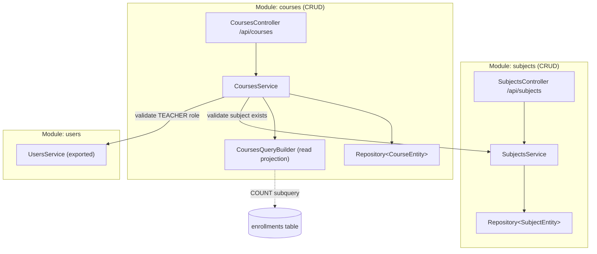

# Plan de Implementación Backend — Épica E2: Materias y Cursos

## 1. Objetivo y Alcance
Implementar la **Épica E2 (Materias y cursos)** en `unicen_backend`, respetando las reglas de [`unicen_backend/AGENTS.md`](../../unicen_backend/AGENTS.md) y las decisiones de [`unicen_backend/docs/decisions.md`](../../unicen_backend/docs/decisions.md).

### Historias de usuario cubiertas
| HU | Prioridad | Resumen backend |
|---|---|---|
| **HU-05** · Catálogo de materias | 🔴 | CRUD `/api/subjects`. `code` único (`409`), `credits > 0`. Listar: cualquier autenticado. No se elimina con cursos asociados (`409`). |
| **HU-06** · Oferta de cursos por gestión | 🔴 | CRUD `/api/courses` (ADMIN). `term` = `YYYY-1`/`YYYY-2`. `(subject, term, section)` único (`409`). El docente debe tener rol `TEACHER`. `maxCapacity` no puede bajar de los inscritos actuales (`409`). |
| **HU-07** · Consultar la oferta | 🔴 | `GET /api/courses?term=2026-2` con materia, paralelo, docente, cupo máximo, **cupos disponibles** e `isEnrolled` del estudiante autenticado. |
| **HU-08** · Mis cursos asignados | 🔴 | `GET /api/courses/mine` (TEACHER). `GET /api/courses/:id/enrolled-students` solo para el docente del curso o ADMIN (`403` en otro caso). |

### Fuera de alcance
- Lógica de inscripción (HU-10 y siguientes, E3). En E2 solo se **lee** el conteo de inscripciones activas.
- Gestión de estudiantes (HU-09: endpoints, service y DTOs de `students`). E2 solo crea la **tabla** `students` y su entidad ORM, porque `enrollments.student_id` apunta a `students.id` (ver §3.3 y BD-018).

---

## 2. Arquitectura (según `AGENTS.md`)

`subjects` y `courses` son **módulos CRUD**: `controller → service → repository (TypeORM)` + `dto/` + entidad. No llevan `domain/`/`application/` (BD-002).



**Reglas aplicadas**
- La comunicación entre módulos pasa por **providers exportados**: `CoursesModule` importa `SubjectsModule` y `UsersModule` y usa `SubjectsService` y `UsersService`. Nunca inyecta `Repository<SubjectEntity>` ni `Repository<UserEntity>`.
- Para evitar una dependencia circular, `SubjectsModule` **no** importa `CoursesModule`. La regla "no eliminar materias con cursos" se resuelve con la FK `ON DELETE RESTRICT` (ver §3.3 y la decisión BD-016).
- **Conteo de inscritos:** `CoursesService` arma una proyección de lectura con una subconsulta SQL `COUNT(*)` sobre `enrollments`. No usa el repositorio de `enrollments`; las escrituras siguen siendo del módulo `enrollments`. Así se evita el N+1 en un solo query (decisión BD-017).
- Los controllers son delgados: DTO → service → DTO de respuesta. Toda regla vive en el service.

---

## 3. Cambios por componente

### 3.1. Errores de dominio (`src/shared/errors/domain.errors.ts`) — [MODIFY]
Se agregan errores que extienden `DomainError`, con JSDoc y mensaje en español:

| Clase | `code` | Mensaje por defecto | HTTP |
|---|---|---|---|
| `DuplicateSubjectCodeError` | `DUPLICATE_SUBJECT_CODE` | `Ya existe una materia con ese código` | 409 |
| `SubjectInUseError` | `SUBJECT_IN_USE` | `No se puede eliminar una materia con cursos asociados` | 409 |
| `DuplicateCourseError` | `DUPLICATE_COURSE` | `Ya existe ese paralelo para la materia en esta gestión` | 409 |
| `InvalidCourseTeacherError` | `INVALID_COURSE_TEACHER` | `El docente asignado debe tener rol docente` | 400 |
| `CapacityBelowEnrollmentError` | `CAPACITY_BELOW_ENROLLMENT` | `El cupo no puede ser menor a los inscritos actuales (N)` | 409 |
| `CourseHasEnrollmentsError` | `COURSE_HAS_ENROLLMENTS` | `No se puede eliminar un curso con inscripciones` | 409 |

`NotFoundError` (existente) se usa con mensajes concretos: `Materia no encontrada`, `Curso no encontrado`, `Docente no encontrado`.

### 3.2. Filtro de excepciones (`src/shared/filters/domain-exception.filter.ts`) — [MODIFY]
La cadena de `instanceof` crecería demasiado. Se reemplaza por un mapa `code → HttpStatus`, con `BAD_REQUEST` por defecto. Así `catch()` queda corto (< 50 líneas) y cada error nuevo solo suma una línea:

```ts
const STATUS_BY_CODE: Record<string, HttpStatus> = {
  COURSE_FULL: HttpStatus.CONFLICT,
  DUPLICATE_ENROLLMENT: HttpStatus.CONFLICT,
  DUPLICATE_USER_EMAIL: HttpStatus.CONFLICT,
  DUPLICATE_SUBJECT_CODE: HttpStatus.CONFLICT,
  SUBJECT_IN_USE: HttpStatus.CONFLICT,
  DUPLICATE_COURSE: HttpStatus.CONFLICT,
  CAPACITY_BELOW_ENROLLMENT: HttpStatus.CONFLICT,
  COURSE_HAS_ENROLLMENTS: HttpStatus.CONFLICT,
  INVALID_CREDENTIALS: HttpStatus.UNAUTHORIZED,
  FORBIDDEN_ACTION: HttpStatus.FORBIDDEN,
  NOT_FOUND: HttpStatus.NOT_FOUND,
};
```
El formato de respuesta no cambia: `{ statusCode, error, message, timestamp }`.

Se agrega un helper en `src/shared/utils/postgres-error.utils.ts` [NEW]: `isUniqueViolation(err)` (`23505`) e `isForeignKeyViolation(err)` (`23503`) sobre `QueryFailedError`. Respaldan las validaciones previas ante condiciones de carrera.

### 3.3. Migración (`src/database/migrations/<timestamp>-create-subjects-and-courses.ts`) — [NEW]
Se genera con `npm run migration:generate` y se revisa a mano. Contenido esperado:

```sql
CREATE TABLE "subjects" (
  "id" uuid NOT NULL DEFAULT uuid_generate_v4(),
  "code" varchar(20) NOT NULL,
  "name" varchar(150) NOT NULL,
  "credits" smallint NOT NULL,
  "created_at" TIMESTAMPTZ NOT NULL DEFAULT now(),
  "updated_at" TIMESTAMPTZ NOT NULL DEFAULT now(),
  CONSTRAINT "PK_subjects_id" PRIMARY KEY ("id"),
  CONSTRAINT "UQ_subjects_code" UNIQUE ("code"),
  CONSTRAINT "CHK_subjects_credits" CHECK ("credits" > 0)
);

CREATE TABLE "courses" (
  "id" uuid NOT NULL DEFAULT uuid_generate_v4(),
  "subject_id" uuid NOT NULL,
  "teacher_id" uuid NOT NULL,
  "term" varchar(6) NOT NULL,
  "section" varchar(10) NOT NULL,
  "max_capacity" integer NOT NULL,
  "created_at" TIMESTAMPTZ NOT NULL DEFAULT now(),
  "updated_at" TIMESTAMPTZ NOT NULL DEFAULT now(),
  CONSTRAINT "PK_courses_id" PRIMARY KEY ("id"),
  CONSTRAINT "UQ_courses_subject_term_section" UNIQUE ("subject_id", "term", "section"),
  CONSTRAINT "CHK_courses_max_capacity" CHECK ("max_capacity" > 0),
  CONSTRAINT "CHK_courses_term" CHECK ("term" ~ '^[0-9]{4}-[12]$'),
  CONSTRAINT "FK_courses_subject" FOREIGN KEY ("subject_id") REFERENCES "subjects"("id") ON DELETE RESTRICT,
  CONSTRAINT "FK_courses_teacher" FOREIGN KEY ("teacher_id") REFERENCES "users"("id") ON DELETE RESTRICT
);
CREATE INDEX "IDX_courses_term" ON "courses" ("term");
CREATE INDEX "IDX_courses_teacher_id" ON "courses" ("teacher_id");
```

**Dependencia con `students` y `enrollments`:** la proyección de cupos lee `enrollments`, y `enrollments.student_id` apunta al **perfil de estudiante** (`students.id`, HU-09), no a `users.id`. Para que E2 funcione solo, esta migración crea ambas tablas con el esquema acordado (decisión BD-018). HU-09 y E3 agregan la lógica sin reescribir la migración; si necesitan columnas nuevas, las agregan con otra.

```sql
-- Perfil académico del estudiante (HU-09). name y email viven en users.
CREATE TABLE "students" (
  "id" uuid NOT NULL DEFAULT uuid_generate_v4(),
  "user_id" uuid NOT NULL,
  "student_code" varchar(20) NOT NULL,
  "program" varchar(150) NOT NULL,
  "created_at" TIMESTAMPTZ NOT NULL DEFAULT now(),
  "updated_at" TIMESTAMPTZ NOT NULL DEFAULT now(),
  CONSTRAINT "PK_students_id" PRIMARY KEY ("id"),
  CONSTRAINT "UQ_students_user_id" UNIQUE ("user_id"),
  CONSTRAINT "UQ_students_student_code" UNIQUE ("student_code"),
  CONSTRAINT "FK_students_user" FOREIGN KEY ("user_id") REFERENCES "users"("id") ON DELETE RESTRICT
);

CREATE TYPE "enrollments_status_enum" AS ENUM ('ACTIVE', 'CANCELLED');
CREATE TABLE "enrollments" (
  "id" uuid NOT NULL DEFAULT uuid_generate_v4(),
  "student_id" uuid NOT NULL,
  "course_id" uuid NOT NULL,
  "status" "enrollments_status_enum" NOT NULL DEFAULT 'ACTIVE',
  "created_at" TIMESTAMPTZ NOT NULL DEFAULT now(),
  "updated_at" TIMESTAMPTZ NOT NULL DEFAULT now(),
  CONSTRAINT "PK_enrollments_id" PRIMARY KEY ("id"),
  CONSTRAINT "UQ_enrollments_student_course" UNIQUE ("student_id", "course_id"),
  CONSTRAINT "FK_enrollments_student" FOREIGN KEY ("student_id") REFERENCES "students"("id") ON DELETE RESTRICT,
  CONSTRAINT "FK_enrollments_course" FOREIGN KEY ("course_id") REFERENCES "courses"("id") ON DELETE RESTRICT
);
```
Las entidades ORM se alinean a este esquema sin agregar lógica:
- `StudentEntity` (`modules/students/student.entity.ts`): `id`, `userId` (`user_id`), `studentCode` (`student_code`), `program` y timestamps, con `@OneToOne(() => UserEntity)` y `@JoinColumn({ name: 'user_id' })`.
- `EnrollmentOrmEntity`: `studentId` (→ `students.id`), `courseId`, `status`, `createdAt` y `updatedAt`.

`down()` elimina en orden inverso: `enrollments`, su enum, `students`, `courses` y `subjects`.

### 3.4. Módulo `subjects` (HU-05)

#### `subject.entity.ts` — [MODIFY]
`SubjectEntity` con `id`, `code` (varchar 20, unique), `name` (varchar 150), `credits` (smallint), `createdAt`/`updatedAt` (`timestamptz`, `created_at`/`updated_at`).

#### `dto/` — [NEW]
- `create-subject.dto.ts` — `CreateSubjectDto`:
  - `code`: `@IsString() @IsNotEmpty() @MaxLength(20) @Matches(/^[A-Z0-9-]+$/)`, se normaliza con `@Transform(trim + toUpperCase)`.
  - `name`: `@IsString() @IsNotEmpty() @MaxLength(150)`.
  - `credits`: `@IsInt() @Min(1) @Max(20)`.
- `update-subject.dto.ts` — `UpdateSubjectDto extends PartialType(CreateSubjectDto)` (de `@nestjs/swagger`).
- `subject-response.dto.ts` — `SubjectResponseDto { id, code, name, credits, createdAt }` + `static fromEntity()`.

#### `subjects.service.ts` — [MODIFY]
Todos los métodos llevan JSDoc con `@throws`.
| Método | Comportamiento |
|---|---|
| `create(dto)` | Si `existsBy({ code })` → `DuplicateSubjectCodeError`. Guarda. Si hay `23505` por carrera → `DuplicateSubjectCodeError`. |
| `findAll()` | Ordena por `code ASC` y devuelve `SubjectResponseDto[]`. |
| `findOne(id)` | `NotFoundError('Materia no encontrada')` si no existe. |
| `update(id, dto)` | `findEntityOrFail`; si cambia `code` y ya existe en otra materia → `DuplicateSubjectCodeError`. |
| `remove(id)` | `findEntityOrFail` → `delete`. Si hay `23503` (FK de `courses`) → `SubjectInUseError`. |
| `findEntityById(id)` | **Exportado** para `courses`: devuelve `SubjectEntity \| null`. |

#### `subjects.controller.ts` — [MODIFY]
`@ApiTags('Subjects') @ApiBearerAuth()`. Cada endpoint lleva `@ApiOperation`, `@ApiResponse` y JSDoc. Los ids usan `ParseUUIDPipe`.

| Método | Ruta | Roles | Respuesta |
|---|---|---|---|
| `GET` | `/api/subjects` | Autenticado | `200 SubjectResponseDto[]` |
| `GET` | `/api/subjects/:id` | Autenticado | `200` · `404` |
| `POST` | `/api/subjects` | `ADMIN` | `201` · `400` · `409` |
| `PATCH` | `/api/subjects/:id` | `ADMIN` | `200` · `404` · `409` |
| `DELETE` | `/api/subjects/:id` | `ADMIN` | `204` (`@HttpCode(NO_CONTENT)`) · `404` · `409` |

### 3.5. Módulo `courses` (HU-06, HU-07, HU-08)

#### `course.entity.ts` — [MODIFY]
`CourseEntity`: `id`, `subjectId` (`subject_id`), `teacherId` (`teacher_id`), `term`, `section`, `maxCapacity` (`max_capacity`), timestamps. Relaciones `@ManyToOne(() => SubjectEntity)` con `@JoinColumn({ name: 'subject_id' })` y `@ManyToOne(() => UserEntity)` con `@JoinColumn({ name: 'teacher_id' })`. Se usan **solo para joins de lectura**; no se usa `eager`.

#### `dto/` — [NEW]
- `create-course.dto.ts` — `CreateCourseDto`:
  - `subjectId`: `@IsUUID()`
  - `teacherId`: `@IsUUID()`
  - `term`: `@Matches(/^\d{4}-[12]$/, { message: 'La gestión debe tener el formato AAAA-1 o AAAA-2' })`
  - `section`: `@IsString() @IsNotEmpty() @MaxLength(10)` + `@Transform(trim + toUpperCase)`
  - `maxCapacity`: `@IsInt() @Min(1) @Max(500)`
- `update-course.dto.ts` — `UpdateCourseDto extends PartialType(CreateCourseDto)`.
- `list-courses-query.dto.ts` — `ListCoursesQueryDto { term?: string (mismo @Matches); subjectId?: string (@IsUUID) }`.
- `course-response.dto.ts` — `CourseResponseDto`:
  ```ts
  { id, term, section, maxCapacity, enrolledCount, availableSeats, isEnrolled,
    subject: { id, code, name, credits }, teacher: { id, name } }
  ```
  Usa los sub-DTO `CourseSubjectDto` y `CourseTeacherDto`. Nunca expone `email` ni `passwordHash` del docente.
- `enrolled-student-response.dto.ts` — `EnrolledStudentResponseDto { enrollmentId, studentId, studentCode, name, email, program, enrolledAt }`. `studentId` es `students.id`; `name` y `email` vienen de `users`.

#### `courses-query.builder.ts` — [NEW] (proyección de lectura, < 150 líneas)
Clase `@Injectable() CoursesQueryBuilder`. Recibe `Repository<CourseEntity>` y encapsula los selects para que `CoursesService` no supere ~50 líneas por método:
- `findMany(filters: { term?, subjectId?, teacherId? }, viewerUserId?: string): Promise<CourseView[]>`. Hace un único query con `leftJoin subject`, `leftJoin teacher` y estas expresiones:
  ```sql
  (SELECT COUNT(*) FROM enrollments e WHERE e.course_id = c.id AND e.status = 'ACTIVE')::int AS enrolled_count,
  EXISTS (
    SELECT 1 FROM enrollments e
    JOIN students s ON s.id = e.student_id
    WHERE e.course_id = c.id AND s.user_id = :viewerUserId AND e.status = 'ACTIVE'
  ) AS is_enrolled
  ```
  El token solo trae `sub` (`users.id`), así que el estudiante se resuelve con `students.user_id` dentro de la misma subconsulta, sin un query extra. Si el usuario STUDENT aún no tiene perfil en `students`, `is_enrolled` es `false`. Ordena por `subject.code ASC, section ASC`.
- `findOneView(id, viewerUserId?)`: la misma proyección para un curso.
- `countActiveEnrollments(courseId, manager?: EntityManager)`: se usa al validar `maxCapacity` dentro de la transacción.
- `findEnrolledStudents(courseId)`: `enrollments` (status `ACTIVE`) `JOIN students JOIN users`, ordenado por `users.name`.

`CourseView` es un tipo interno del módulo (`course-view.type.ts`). `CourseResponseDto.fromView()` lo transforma en la respuesta y calcula `availableSeats = max(maxCapacity - enrolledCount, 0)`.

#### `courses.service.ts` — [MODIFY]
| Método | Reglas |
|---|---|
| `create(dto)` | 1) `subjectsService.findEntityById` → `NotFoundError('Materia no encontrada')`. 2) `assertTeacher(teacherId)`. 3) Si `existsBy({ subjectId, term, section })` → `DuplicateCourseError`. 4) Guarda; si hay `23505` → `DuplicateCourseError`. Devuelve `findOneView`. |
| `findAll(query, viewer)` | `queryBuilder.findMany(query, viewer.role === STUDENT ? viewer.id : undefined)`. `isEnrolled` es `false` para otros roles. |
| `findMine(teacherId)` | `findMany({ teacherId })`. |
| `findOne(id, viewer)` | `NotFoundError('Curso no encontrado')`. |
| `update(id, dto)` | Corre en `dataSource.transaction`: carga el curso con `lock: { mode: 'pessimistic_write' }` (mismo criterio que BD-005, para que no compita con una inscripción). Valida materia y docente si cambian y la unicidad de `(subject, term, section)` si cambia alguno de los tres. Si cambia `maxCapacity`: `countActiveEnrollments(id, manager)`; si `maxCapacity < count` → `CapacityBelowEnrollmentError(count)`. |
| `remove(id)` | `NotFoundError`; si hay `23503` (FK de `enrollments`) → `CourseHasEnrollmentsError`. |
| `findEnrolledStudents(id, viewer)` | El curso debe existir (`404`). Si `viewer.role !== ADMIN && course.teacherId !== viewer.id` → `ForbiddenActionError('Solo el docente del curso puede ver sus inscritos')`. |
| `assertTeacher(teacherId)` *(private)* | `usersService.findById`. Si no existe → `NotFoundError('Docente no encontrado')`. Si `role !== TEACHER` o `!isActive` → `InvalidCourseTeacherError`. |
| `findEntityById(id)` | **Exportado** para que lo use E3 (`enrollments`). |

> La propiedad del curso (docente asignado) es una regla de recurso: se valida en el service y no en el guard (BD-009).

#### `courses.controller.ts` — [MODIFY]
`@ApiTags('Courses') @ApiBearerAuth()`. `/mine` se declara **antes** de `/:id`. Todos los `:id` usan `ParseUUIDPipe`.

| Método | Ruta | Roles | Respuesta |
|---|---|---|---|
| `GET` | `/api/courses?term=&subjectId=` | Autenticado | `200 CourseResponseDto[]` |
| `GET` | `/api/courses/mine` | `TEACHER` | `200 CourseResponseDto[]` |
| `GET` | `/api/courses/:id` | Autenticado | `200` · `404` |
| `GET` | `/api/courses/:id/enrolled-students` | `TEACHER`, `ADMIN` | `200 EnrolledStudentResponseDto[]` · `403` · `404` |
| `POST` | `/api/courses` | `ADMIN` | `201` · `400` · `404` · `409` |
| `PATCH` | `/api/courses/:id` | `ADMIN` | `200` · `400` · `404` · `409` |
| `DELETE` | `/api/courses/:id` | `ADMIN` | `204` · `404` · `409` |

El usuario se obtiene con `@CurrentUser() user: AuthenticatedUser`.

#### `courses.module.ts` — [MODIFY]
```ts
imports: [TypeOrmModule.forFeature([CourseEntity]), SubjectsModule, UsersModule],
providers: [CoursesService, CoursesQueryBuilder],
exports: [CoursesService],
```

### 3.6. Seed idempotente (`src/database/seeds/seed.ts`) — [MODIFY]
El archivo se divide para no superar los límites: `seeds/users.seed.ts`, `seeds/subjects.seed.ts`, `seeds/courses.seed.ts` [NEW] y `seed.ts` como orquestador.
- **Docente extra:** `docente2@unicen.edu.bo` / `Teacher123!` ("Lic. María Rojas"), para probar el `403` de HU-08.
- **Perfil de estudiante** (`seeds/students.seed.ts` [NEW], se omite si ya existe `user_id`): `estudiante@unicen.edu.bo` → `student_code` `S-2026001`, `program` "Ingeniería de Sistemas". Sin este perfil, el estudiante no podría inscribirse en E3 ni aparecer como inscrito.
- **Materias** (se omiten si `code` ya existe): `MAT-101` Cálculo I (5), `FIS-101` Física I (5), `PRG-101` Programación I (4), `BDD-201` Base de Datos I (4), `SIS-301` Ingeniería de Software (4).
- **Cursos** (se omiten si existe `(subject, term, section)`):
  - `2026-2`: MAT-101 A (cupo 30, docente 1), MAT-101 B (cupo 25, docente 2), PRG-101 A (cupo **2**, docente 1, para la demo de curso lleno en E3), BDD-201 A (cupo 20, docente 1), SIS-301 A (cupo 15, docente 2).
  - `2026-1`: FIS-101 A (cupo 30, docente 1), para probar el filtro por gestión.

---

## 4. Pruebas

### 4.1. Unitarias (Jest, `*.spec.ts` junto al archivo, patrón AAA)
`subjects` y `courses` son módulos CRUD (no tienen casos de uso), pero contienen reglas de negocio de E2, así que se prueban sus services con repositorios y services simulados.

**`subjects.service.spec.ts`**
- `creates a subject and returns SubjectResponseDto`
- `throws DuplicateSubjectCodeError when code already exists`
- `throws DuplicateSubjectCodeError when updating to a code used by another subject`
- `throws NotFoundError when subject does not exist`
- `throws SubjectInUseError when deleting a subject with courses (FK 23503)`

**`courses.service.spec.ts`**
- `creates a course when subject exists and teacher has TEACHER role`
- `throws NotFoundError when subject does not exist`
- `throws InvalidCourseTeacherError when assigned user is not a TEACHER`
- `throws DuplicateCourseError when subject, term and section already exist`
- `throws CapacityBelowEnrollmentError when maxCapacity is lower than active enrollments`
- `allows reducing maxCapacity down to the current enrollment count`
- `throws ForbiddenActionError when a teacher requests students of a course they do not teach`
- `returns enrolled students for the assigned teacher and for ADMIN`
- `passes viewer user id to the projection only for STUDENT role`

**`course-response.dto.spec.ts`**
- `computes availableSeats as maxCapacity minus enrolledCount, never negative`

**`domain-exception.filter.spec.ts`** [NEW]
- `maps each E2 domain error code to its HTTP status`

### 4.2. E2E (🟡, `test/courses.e2e-spec.ts`, Supertest)
- ADMIN crea una materia → `201`; el mismo código → `409`.
- STUDENT hace `POST /api/subjects` → `403`.
- ADMIN crea un curso con un docente válido → `201`; con un `STUDENT` como docente → `400`.
- `GET /api/courses?term=2026-2` como STUDENT → incluye `availableSeats` e `isEnrolled`.
- `docente2` hace `GET /api/courses/:id/enrolled-students` de un curso del docente 1 → `403`.

### 4.3. Verificación
```bash
cd unicen_backend
npm run migration:run
npm run seed
npm run lint
npm run build
npm test
```
Revisar también Swagger en `http://localhost:3000/api/docs`: deben aparecer los tags `Subjects` y `Courses` con sus respuestas documentadas.

---

## 5. Decisiones técnicas a registrar en `unicen_backend/docs/decisions.md`
- **BD-016 — Integridad referencial para borrados:** `ON DELETE RESTRICT` en `courses.subject_id` y `enrollments.course_id`; el service traduce el `23503` a un error de dominio `409`. Así `subjects` no depende de `courses` y no hay dependencia circular.
- **BD-017 — Proyección de lectura de cupos:** `courses` calcula `enrolledCount`, `availableSeats` e `isEnrolled` con subconsultas SQL sobre `enrollments` en un solo query (sin N+1). Las escrituras de inscripciones siguen siendo exclusivas del módulo `enrollments`.
- **BD-018 — `enrollments.student_id` apunta al perfil `students.id`:** la inscripción pertenece al perfil académico (HU-09: `student_code`, `program`), no a la cuenta. `students.user_id` (único) enlaza el perfil con `users`, y el estudiante autenticado se resuelve por `user_id` a partir del `sub` del token. E2 adelanta las tablas `students` y `enrollments`; HU-09 y E3 agregan la lógica sin reescribir la migración.
- **BD-019 — Mapa `code → HttpStatus`** en `DomainExceptionFilter`, en lugar de la cadena de `instanceof`.

---

## 6. Checklist de cierre (`AGENTS.md`)
- [ ] `npm run lint`, `npm run build` y `npm test` en verde.
- [ ] Migración creada y probada con `up` y `down`.
- [ ] JSDoc en cada clase, método público y endpoint, más decoradores Swagger en los controllers.
- [ ] Ningún archivo supera 600 líneas ni ningún método ~50.
- [ ] Ninguna respuesta expone `passwordHash`; el docente se expone solo como `{ id, name }`.
- [ ] Commits (Conventional Commits):
  - `feat(subjects): HU-05 subjects catalog CRUD`
  - `feat(courses): HU-06 course offering management`
  - `feat(courses): HU-07 course offering with available seats`
  - `feat(courses): HU-08 teacher courses and enrolled students`
  - `chore(database): seed subjects and courses`
