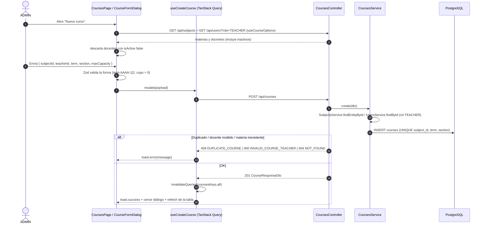
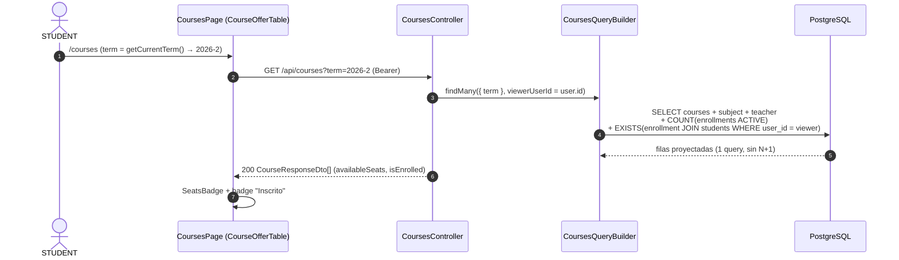
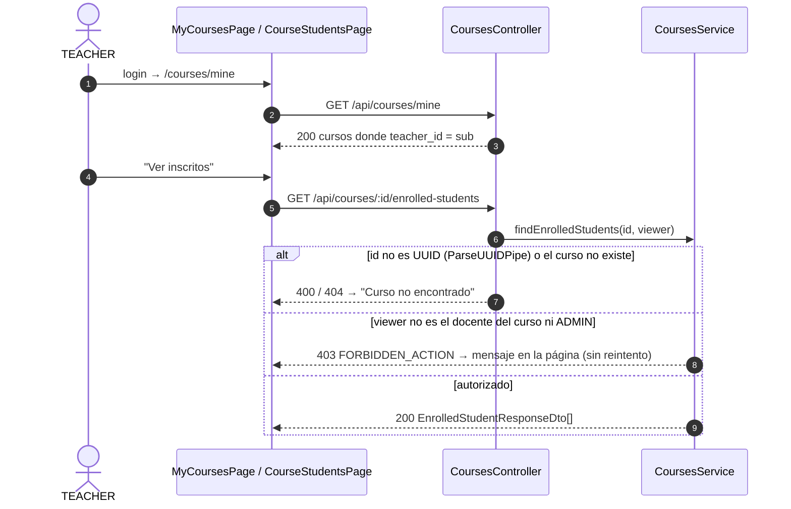

# Plan de Integración (Backend + Frontend) — Épica E2: Materias y Cursos

## 1. Documentos del plan E2
Este plan coordina la implementación de punta a punta de la **Épica E2 (HU-05 a HU-08)** entre los dos módulos del monorepo. Según `CLAUDE.md`, cada módulo respeta su propio `AGENTS.md` en sus archivos.

1. **Backend:** [e2-backend-subjects-courses-plan.md](./e2-backend-subjects-courses-plan.md), regido por [unicen_backend/AGENTS.md](../../unicen_backend/AGENTS.md).
2. **Frontend:** [e2-frontend-subjects-courses-plan.md](./e2-frontend-subjects-courses-plan.md), regido por [unicen_frontend/AGENTS.md](../../unicen_frontend/AGENTS.md) y [DESIGN.md](../../unicen_frontend/DESIGN.md).

**Este documento es la fuente de verdad del contrato HTTP.** Si el backend cambia una forma de respuesta, se actualiza aquí y en `types.ts` del frontend en el mismo PR.

---

## 2. Flujos de punta a punta

### 2.1. ADMIN gestiona la oferta (HU-05 + HU-06)


### 2.2. STUDENT consulta la oferta (HU-07)


### 2.3. TEACHER ve sus cursos e inscritos (HU-08)


---

## 3. Contrato HTTP

Todo usa el prefijo `/api` y requiere `Authorization: Bearer <token>`.

**Formato de errores.** No todos los errores tienen la misma forma:
| Origen | Ejemplos | Cuerpo |
|---|---|---|
| Errores de dominio (`DomainExceptionFilter`) | `409 DUPLICATE_COURSE`, `403 FORBIDDEN_ACTION`, `404 NOT_FOUND` | `{ statusCode, error: <CODE>, message: string, timestamp }` |
| `ValidationPipe` y `ParseUUIDPipe` | `400` por DTO o id inválido | Formato de Nest: `{ statusCode, error: 'Bad Request', message: string \| string[] }`, sin `timestamp` |
| `RolesGuard` y `JwtAuthGuard` | `403` por rol, `401` | Formato de Nest: `{ statusCode, error: 'Forbidden', message }` |

El front muestra `message` con `getApiErrorMessage()`, que ya une los arrays, y **decide qué hacer según el `status` HTTP, nunca según `error`**.

### 3.1. Materias (HU-05)

| Método | Ruta | Roles | Request | Respuesta OK | Errores |
|---|---|---|---|---|---|
| GET | `/subjects` | Todos | — | `200 Subject[]` | 401 |
| GET | `/subjects/:id` | Todos | — | `200 Subject` | 404 |
| POST | `/subjects` | ADMIN | `CreateSubjectRequest` | `201 Subject` | 400, 403, 409 `DUPLICATE_SUBJECT_CODE` |
| PATCH | `/subjects/:id` | ADMIN | `Partial<CreateSubjectRequest>` | `200 Subject` | 400, 403, 404, 409 `DUPLICATE_SUBJECT_CODE` |
| DELETE | `/subjects/:id` | ADMIN | — | `204` | 403, 404, 409 `SUBJECT_IN_USE` |

```jsonc
// POST /api/subjects
{ "code": "MAT-101", "name": "Cálculo I", "credits": 5 }

// 201 Subject
{ "id": "3f1c…", "code": "MAT-101", "name": "Cálculo I", "credits": 5, "createdAt": "2026-10-27T15:00:00.000Z" }

// 409
{ "statusCode": 409, "error": "DUPLICATE_SUBJECT_CODE", "message": "Ya existe una materia con ese código", "timestamp": "…" }
```

### 3.2. Cursos (HU-06, HU-07, HU-08)

| Método | Ruta | Roles | Request | Respuesta OK | Errores |
|---|---|---|---|---|---|
| GET | `/courses?term=&subjectId=` | Todos | query opcional | `200 Course[]` | 400 (term inválido) |
| GET | `/courses/mine` | TEACHER | — | `200 Course[]` | 403 |
| GET | `/courses/:id` | Todos | — | `200 Course` | 404 |
| GET | `/courses/:id/enrolled-students` | TEACHER (propio), ADMIN | — | `200 EnrolledStudent[]` | 403 `FORBIDDEN_ACTION`, 404 |
| POST | `/courses` | ADMIN | `CreateCourseRequest` | `201 Course` | 400 `INVALID_COURSE_TEACHER`, 404, 409 `DUPLICATE_COURSE` |
| PATCH | `/courses/:id` | ADMIN | `Partial<CreateCourseRequest>` | `200 Course` | 400, 404, 409 `DUPLICATE_COURSE` / `CAPACITY_BELOW_ENROLLMENT` |
| DELETE | `/courses/:id` | ADMIN | — | `204` | 404, 409 `COURSE_HAS_ENROLLMENTS` |

```jsonc
// POST /api/courses
{
  "subjectId": "3f1c…",
  "teacherId": "9a2b…",
  "term": "2026-2",
  "section": "A",
  "maxCapacity": 30
}

// 200/201 Course (también cada elemento de GET /courses)
{
  "id": "c7d8…",
  "term": "2026-2",
  "section": "A",
  "maxCapacity": 30,
  "enrolledCount": 18,
  "availableSeats": 12,
  "isEnrolled": false,           // true solo si el viewer es STUDENT y su perfil (students.user_id) tiene inscripción ACTIVE
  "subject": { "id": "3f1c…", "code": "MAT-101", "name": "Cálculo I", "credits": 5 },
  "teacher": { "id": "9a2b…", "name": "Dr. Carlos Mendoza" }   // nunca email ni passwordHash
}

// 200 EnrolledStudent[]
// studentId = students.id (perfil), no users.id
[{
  "enrollmentId": "e1…",
  "studentId": "s3…",
  "studentCode": "S-2026001",
  "name": "Ana Sofía Vargas",
  "email": "estudiante@unicen.edu.bo",
  "program": "Ingeniería de Sistemas",
  "enrolledAt": "2026-10-27T15:10:00.000Z"
}]

// 409 cupo menor a inscritos
{ "statusCode": 409, "error": "CAPACITY_BELOW_ENROLLMENT", "message": "El cupo no puede ser menor a los inscritos actuales (18)", "timestamp": "…" }
```

### 3.3. Endpoint existente que se reutiliza
- `GET /api/users?role=TEACHER` (E1, ADMIN): llena el select de docentes. Devuelve también docentes inactivos, y `CoursesService.assertTeacher` los rechaza con `400 INVALID_COURSE_TEACHER`. Por eso el front usa `{ id, name, isActive }` y descarta los inactivos. Al editar un curso cuyo docente ya está inactivo, el front lo agrega a las opciones para no dejar el select vacío; el backend solo lo valida si cambia.

### 3.4. Correspondencia de tipos
| Backend (DTO) | Frontend (`types.ts`) |
|---|---|
| `SubjectResponseDto` | `subjects/types.ts → Subject` |
| `CreateSubjectDto` / `UpdateSubjectDto` | `CreateSubjectRequest` / `UpdateSubjectRequest` |
| `CourseResponseDto` (+ `CourseSubjectDto`, `CourseTeacherDto`) | `courses/types.ts → Course` (+ `CourseSubject`, `CourseTeacher`) |
| `CreateCourseDto` / `UpdateCourseDto` | `CreateCourseRequest` / `UpdateCourseRequest` |
| `ListCoursesQueryDto` | `CoursesFilters` |
| `EnrolledStudentResponseDto` | `EnrolledStudent` |

Las fechas viajan como string ISO 8601 y el front las formatea con `formatDate()` (`shared/lib/date.utils.ts`, `Intl.DateTimeFormat('es-BO')`).

`GET /courses?term=` responde `400` con un `term` mal formado. El front valida `?term=` con `isValidTerm()` antes de llamar y, si no cumple, usa `getCurrentTerm()`.

### 3.5. Validaciones en cada capa
| Regla | Zod (front, forma) | class-validator (DTO) | Service (negocio) | Base de datos (respaldo) |
|---|---|---|---|---|
| `code` con formato y hasta 20 caracteres | ✅ | ✅ | — | `varchar(20)` |
| `code` único | — | — | ✅ `DuplicateSubjectCodeError` | `UNIQUE` |
| `credits` > 0 | ✅ | ✅ | — | `CHECK` |
| `term` `AAAA-1/2` | ✅ | ✅ | — | `CHECK` |
| `(subject, term, section)` único | — | — | ✅ `DuplicateCourseError` | `UNIQUE` |
| Docente con rol `TEACHER` | — | — | ✅ `InvalidCourseTeacherError` | — |
| `maxCapacity` ≥ inscritos | — (solo > 0) | `@Min(1)` | ✅ con lock (`pessimistic_write`) | `CHECK > 0` |
| No borrar materia con cursos | — | — | ✅ traduce `23503` | `FK RESTRICT` |
| Solo el docente del curso ve sus inscritos | Ruta por rol (UX) | — | ✅ `ForbiddenActionError` | — |

---

## 4. Matriz de roles y rutas de E2

| Funcionalidad | API | SPA | ADMIN | TEACHER | STUDENT |
|---|---|---|---|---|---|
| Ver catálogo de materias | `GET /subjects` | `/subjects` | ✅ | ✅ | ✅ |
| Crear, editar o eliminar materia | `POST/PATCH/DELETE /subjects` | acciones en `/subjects` | ✅ | ❌ oculto / 403 | ❌ oculto / 403 |
| Ver oferta por gestión | `GET /courses?term=` | `/courses` | ✅ (gestión) | ✅ (lectura) | ✅ (con `isEnrolled`) |
| Crear, editar o eliminar curso | `POST/PATCH/DELETE /courses` | acciones en `/courses` | ✅ | ❌ | ❌ |
| Mis cursos | `GET /courses/mine` | `/courses/mine` | ❌ 403 | ✅ *(inicio)* | ❌ → `/403` |
| Inscritos de un curso | `GET /courses/:id/enrolled-students` | `/courses/:courseId/students` | ✅ | ✅ solo propios | ❌ → `/403` |

---

## 5. Orden de ejecución

### Fase 1 — Backend: esquema y datos
1. Errores de dominio de E2 y el mapa `code → HttpStatus` en `DomainExceptionFilter`, más `postgres-error.utils.ts`.
2. `SubjectEntity`, `CourseEntity`, `StudentEntity` y el ajuste de `EnrollmentOrmEntity`.
3. Migración `create-subjects-and-courses`, que también crea `students` y `enrollments` (`student_id → students.id`). Probar `migration:run` y `migration:revert`.
4. Seed modular (docente 2, perfil del estudiante, 5 materias, 6 cursos en 2026-2 y 2026-1) y probar que sea idempotente corriéndolo dos veces.

### Fase 2 — Backend: API
5. `subjects`: DTOs, service, controller y specs. **Commit:** `feat(subjects): HU-05 subjects catalog CRUD`.
6. `courses`: DTOs, `CoursesQueryBuilder`, service, controller (`/mine` antes de `/:id`) y specs.
   **Commits:** `feat(courses): HU-06 …`, `feat(courses): HU-07 …`, `feat(courses): HU-08 …`.
7. `npm run lint && npm run build && npm test`. Revisar Swagger en `/api/docs`.

### Fase 3 — Frontend: base
8. Renombrar `materias` → `subjects` y `cursos` → `courses`; instalar los componentes shadcn; crear `DataState`, `TableSkeleton` y `ConfirmDialog`.
   **Commit:** `refactor(frontend): rename subjects and courses features to english`.

> Las fases 3 a 5 pueden empezar en paralelo con la fase 2 usando este contrato como mock, porque los `types.ts` salen de §3.

### Fase 4 — Frontend: materias
9. `types`, `schema`, `service`, `keys`, hooks y componentes de `subjects`, más `SubjectsPage` en el router.
   **Commit:** `feat(subjects): HU-05 subjects catalog page`.

### Fase 5 — Frontend: cursos
10. `term.utils`, `seats.utils`, services (`courses` y `course-options`), keys y hooks.
11. `CoursesPage` (gestión y oferta), `MyCoursesPage` y `CourseStudentsPage`; router, `nav-items` y ruta por defecto del TEACHER.
12. `npm run lint && npm run build`.
   **Commits:** `feat(courses): HU-06 course management for admin`, `feat(courses): HU-07 …`, `feat(courses): HU-08 …`.

### Fase 6 — Integración y verificación
13. Correr `docker compose up --build` desde cero (migraciones y seed automáticos) y luego el smoke test de §6 y la matriz manual del plan frontend (§6.2).
14. Registrar las decisiones FD-011 a FD-015 en `unicen_frontend/docs/decisions.md` (BD-016 a BD-019 ya están en el backend).
    **Commit:** `docs: record E2 technical decisions`.

---

## 6. Smoke test de la API (después del seed)
```bash
API=http://localhost/api

ADMIN=$(curl -s -X POST $API/auth/login -H 'Content-Type: application/json' \
  -d '{"email":"admin@unicen.edu.bo","password":"Admin123!"}' | jq -r .accessToken)
STUDENT=$(curl -s -X POST $API/auth/login -H 'Content-Type: application/json' \
  -d '{"email":"estudiante@unicen.edu.bo","password":"Student123!"}' | jq -r .accessToken)
TEACHER2=$(curl -s -X POST $API/auth/login -H 'Content-Type: application/json' \
  -d '{"email":"docente2@unicen.edu.bo","password":"Teacher123!"}' | jq -r .accessToken)

# HU-05: código duplicado → 409
curl -s -o /dev/null -w '%{http_code}\n' -X POST $API/subjects -H "Authorization: Bearer $ADMIN" \
  -H 'Content-Type: application/json' -d '{"code":"MAT-101","name":"X","credits":3}'

# HU-05: STUDENT no puede crear → 403
curl -s -o /dev/null -w '%{http_code}\n' -X POST $API/subjects -H "Authorization: Bearer $STUDENT" \
  -H 'Content-Type: application/json' -d '{"code":"TMP-1","name":"X","credits":3}'

# HU-07: oferta con cupos
curl -s "$API/courses?term=2026-2" -H "Authorization: Bearer $STUDENT" | jq '.[] | {subject: .subject.code, section, availableSeats, isEnrolled}'

# HU-08: docente 2 sobre un curso del docente 1 → 403
COURSE=$(curl -s "$API/courses?term=2026-2" -H "Authorization: Bearer $ADMIN" | jq -r '[.[] | select(.teacher.name=="Dr. Carlos Mendoza")][0].id')
curl -s -o /dev/null -w '%{http_code}\n' "$API/courses/$COURSE/enrolled-students" -H "Authorization: Bearer $TEACHER2"
```
Resultados esperados: `409`, `403`, una lista con `availableSeats` y luego `403`.

---

## 7. Riesgos y puntos a confirmar
| # | Tema | Propuesta | Acción |
|---|---|---|---|
| 1 | Tablas `students` y `enrollments` antes de HU-09 y E3 | E2 las crea; `enrollments.student_id → students.id` y `students.user_id → users.id` (único) | **Decidido** (BD-018). HU-09 debe crear el perfil `students` junto con el usuario STUDENT; un STUDENT sin perfil ve `isEnrolled: false` |
| 2 | `/courses/mine` vs `/courses/:id` | Declarar `mine` primero y usar `ParseUUIDPipe` en `:id` | Cubierto en el plan backend |
| 3 | Dependencia circular `subjects` ↔ `courses` | `subjects` no importa `courses`; el borrado se protege con `FK RESTRICT` | BD-016 |
| 4 | Edición de cupo concurrente con inscripciones | Lock `pessimistic_write` sobre el curso, como BD-005 | Cubierto |
| 5 | Selects de materias y docentes en `courses` sin importar `subjects` | `course-options.service.ts` propio | FD-011 |
| 6 | Docente desactivado con cursos asignados | El backend valida `isActive` solo al asignar; los cursos existentes no cambian. El front filtra inactivos en el select y conserva el docente actual al editar | Cubierto (§3.3) |
| 7 | Materia nueva ausente del select de cursos | `subjects` no puede invalidar queries de `courses`; `useCourseOptions` usa `refetchOnMount: 'always'` y sus keys viven fuera de `coursesKeys.all` | Cubierto en el plan frontend |

---

## 8. Definición de terminado de E2
- [ ] HU-05 a HU-08 cumplen los criterios de aceptación de [docs/tasks.md](../tasks.md).
- [ ] Backend: `lint`, `build` y `test` en verde; migración reversible; seed idempotente; Swagger actualizado.
- [ ] Frontend: `lint` y `build` en verde; límites de líneas respetados; estados de carga, vacío y error en todas las vistas.
- [ ] El contrato de §3 coincide con los DTOs y con los `types.ts`.
- [ ] `docker compose up --build` desde cero levanta E2 funcional con los datos del seed.
- [ ] Decisiones registradas y commits por historia con Conventional Commits.
