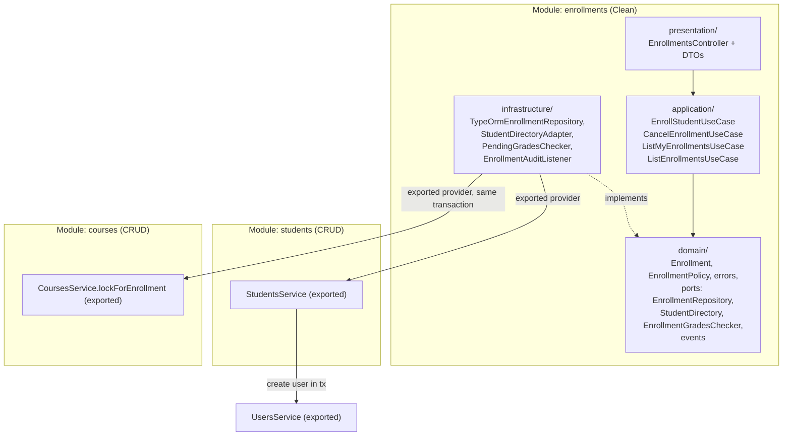

# Plan de Implementación Backend — Épica E3: Estudiantes e Inscripciones

## 1. Objetivo y Alcance
Implementar la **Épica E3 (Estudiantes e inscripciones)** en `unicen_backend`, respetando las reglas de [`unicen_backend/AGENTS.md`](../../unicen_backend/AGENTS.md) y las decisiones de [`unicen_backend/docs/decisions.md`](../../unicen_backend/docs/decisions.md) (BD-001 a BD-019).

Parte del estado que dejó E2 (commit `3b078e8`):
- Las tablas `students` y `enrollments` **ya existen** (migración `1761609600000`), con `enrollments.student_id → students.id`, `status ACTIVE|CANCELLED` y `UNIQUE (student_id, course_id)` (BD-018).
- `StudentEntity` y `EnrollmentOrmEntity` ya están alineadas a ese esquema. `students` y `enrollments` tienen controller, service y casos de uso **vacíos**.
- `CoursesQueryBuilder` ya calcula `enrolledCount` e `isEnrolled` leyendo `enrollments`; E3 solo escribe.

### Historias de usuario cubiertas
| HU | Prioridad | Resumen backend |
|---|---|---|
| **HU-09** · Registrar estudiantes | 🔴 | `students` CRUD (ADMIN). Crea en una transacción el usuario `STUDENT` y su perfil (`studentCode` único, `email` único, `program`). Listar, editar y desactivar. |
| **HU-10** · Inscribirme a un curso ⭐ | 🔴 | `EnrollStudentUseCase`: transacción + `SELECT … FOR UPDATE` sobre el curso. `CourseFullError` (409) y `DuplicateEnrollmentError` (409). Emite `enrollment.created`. |
| **HU-11** · Inscribir a un estudiante (admin) | 🟡 | El **mismo** caso de uso con `studentId` explícito. |
| **HU-12** · Ver mis inscripciones | 🔴 | `GET /api/enrollments/mine?term=`. |
| **HU-13** · Cancelar una inscripción | 🟡 | `CancelEnrollmentUseCase`: cambia el estado a `CANCELLED` (sin borrado físico). `409` si ya tiene notas. |

### Fuera de alcance
- La tabla `grades` y el registro de notas (E4). La regla de HU-13 "no cancelar con notas" queda detrás de un **puerto** que E4 conecta (ver §3.5).

---

## 2. Arquitectura (según `AGENTS.md`)

| Módulo | Estilo | Motivo |
|---|---|---|
| `students` | **CRUD** (`controller → service → repository`) | Solo persiste datos (BD-002). |
| `enrollments` | **Clean Architecture** (`domain/`, `application/`, `infrastructure/`, `presentation/`) | Concentra la regla central del sistema (cupo, duplicado y concurrencia). |



**Reglas aplicadas**
- `domain/` no importa NestJS, TypeORM ni nada de fuera de `domain/`. Los puertos son interfaces con tokens `UPPER_SNAKE_CASE`.
- Los casos de uso tienen un único `execute()` (BD-004) y dependen solo de puertos.
- Entre módulos solo se usan **providers exportados**: `enrollments` importa `StudentsModule` y `CoursesModule`. Ninguno de los dos importa `enrollments`, así que no hay ciclo.
- Los controllers son delgados: DTO → caso de uso → DTO de respuesta.

---

## 3. Cambios por componente

### 3.1. Errores de dominio (`src/shared/errors/domain.errors.ts`) — [MODIFY]
| Clase | `code` | Mensaje por defecto | HTTP |
|---|---|---|---|
| `CourseFullError` *(existe)* | `COURSE_FULL` | `El curso no tiene cupos disponibles` | 409 |
| `DuplicateEnrollmentError` *(existe; se ajusta el mensaje)* | `DUPLICATE_ENROLLMENT` | `Ya estás inscrito en este curso` *(texto de `tasks.md`)* | 409 |
| `DuplicateStudentCodeError` | `DUPLICATE_STUDENT_CODE` | `Ya existe un estudiante con ese código` | 409 |
| `InactiveStudentError` | `INACTIVE_STUDENT` | `El estudiante está inactivo` | 409 |
| `StudentProfileNotFoundError` | `STUDENT_PROFILE_NOT_FOUND` | `No tienes un perfil de estudiante registrado` | 404 |
| `EnrollmentAlreadyCancelledError` | `ENROLLMENT_ALREADY_CANCELLED` | `La inscripción ya está cancelada` | 409 |
| `EnrollmentHasGradesError` | `ENROLLMENT_HAS_GRADES` | `No se puede cancelar una inscripción con notas registradas` | 409 |
| `StudentRequiredError` | `STUDENT_REQUIRED` | `Debes indicar el estudiante a inscribir` | 400 |

Cada código nuevo suma una línea en `STATUS_BY_CODE` (`domain-exception.filter.ts`), y `domain-exception.filter.spec.ts` se amplía con esos casos.

> **Ubicación:** los errores compartidos viven hoy en `shared/errors`. Para no partir el mapeo, los de inscripciones se agregan ahí también (decisión **BD-024**). `domain/` de `enrollments` los importa desde `shared/errors`, que no tiene dependencias de framework.

### 3.2. Módulo `users` — [MODIFY]
- `UsersService.create(dto, manager?: EntityManager)`: con `manager`, usa `manager.getRepository(UserEntity)` para participar en la transacción de `StudentsService`.
- `UsersService.update(id, data, manager?)` [NEW]: actualiza `name`, `email` (verificando unicidad) e `isActive`.
- `CreateUserDto` / `UsersService.create` vía `POST /api/users`: **rechaza `role = STUDENT`** con `400` (`@IsIn([Role.ADMIN, Role.TEACHER])` en un DTO `CreateStaffUserDto` usado por el controller). Así ningún STUDENT queda sin perfil (BD-022). `UsersService.create` interno sigue aceptando `STUDENT` para que lo use `students`.

### 3.3. Módulo `students` (HU-09) — CRUD

#### `dto/` — [NEW]
- `create-student.dto.ts` — `CreateStudentDto`:
  - `name`: `@IsString() @IsNotEmpty() @MaxLength(150)`
  - `email`: `@IsEmail() @MaxLength(255)` (`@Transform` trim + lowercase)
  - `password`: `@IsString() @MinLength(6) @MaxLength(72)` (contraseña inicial que define el ADMIN)
  - `studentCode`: `@Matches(/^[A-Z0-9-]+$/) @MaxLength(20)` (`@Transform` trim + uppercase)
  - `program`: `@IsString() @IsNotEmpty() @MaxLength(150)`
- `update-student.dto.ts` — `UpdateStudentDto` = `PartialType(OmitType(CreateStudentDto, ['password']))`.
- `update-student-status.dto.ts` — `{ isActive: boolean }` (`@IsBoolean()`).
- `list-students-query.dto.ts` — `{ search?: string (@MaxLength(100)); isActive?: boolean (@Transform 'true'/'false') }`.
- `student-response.dto.ts` — `StudentResponseDto { id, userId, studentCode, name, email, program, isActive, createdAt }` + `static fromEntity(student)`, que requiere la relación `user` cargada. Nunca expone `passwordHash`.

#### `students.service.ts` — [MODIFY]
| Método | Reglas |
|---|---|
| `create(dto)` | `dataSource.transaction`: 1) `studentCode` existente → `DuplicateStudentCodeError`; 2) `usersService.create({ name, email, password, role: STUDENT }, manager)` (email duplicado → `DuplicateUserEmailError`); 3) guarda el perfil. Ante `23505`, traduce según la constraint (`UQ_students_student_code` → código, `UQ_users_email` → email). |
| `findAll(query)` | `JOIN user`; `search` con `ILIKE` sobre `users.name`, `users.email` y `students.student_code`; filtro `isActive`; orden `users.name ASC`. |
| `findOne(id)` | `NotFoundError('Estudiante no encontrado')`. |
| `update(id, dto)` | En una transacción: actualiza `users` (`name`, `email`) y `students` (`studentCode`, `program`) verificando unicidad. |
| `updateStatus(id, isActive)` | `usersService.update(userId, { isActive })`. Desactivar **no cancela** inscripciones (decisión BD-023); impide iniciar sesión (lo hace `LoginUseCase`) y nuevas inscripciones. |
| `findByUserId(userId)` | **Exportado** para `enrollments`: perfil + `user.isActive`, o `null`. |
| `findById(id)` | **Exportado** para `enrollments` (inscripción por ADMIN). |

#### `students.controller.ts` — [MODIFY]
`@ApiTags('Students') @ApiBearerAuth() @Roles(Role.ADMIN)` a nivel de clase. Cada endpoint lleva JSDoc y Swagger, y los `:id` usan `ParseUUIDPipe`.
| Método | Ruta | Respuesta |
|---|---|---|
| `POST` | `/api/students` | `201 StudentResponseDto` · `400` · `409 DUPLICATE_STUDENT_CODE / DUPLICATE_USER_EMAIL` |
| `GET` | `/api/students?search=&isActive=` | `200 StudentResponseDto[]` |
| `GET` | `/api/students/:id` | `200` · `404` |
| `PATCH` | `/api/students/:id` | `200` · `404` · `409` |
| `PATCH` | `/api/students/:id/status` | `200` · `404` |

#### `students.module.ts` — [MODIFY]
`imports: [TypeOrmModule.forFeature([StudentEntity]), UsersModule]`, `exports: [StudentsService]`.

### 3.4. `CoursesService` — [MODIFY] (un método)
```ts
/**
 * Locks a course row for an enrollment transaction (SELECT … FOR UPDATE).
 * @param id - Course UUID.
 * @param manager - Transaction manager owned by the caller.
 * @returns Capacity data of the locked course, or null if it does not exist.
 */
async lockForEnrollment(id: string, manager: EntityManager): Promise<{ id: string; maxCapacity: number } | null>
```
Usa el mismo `lock: { mode: 'pessimistic_write' }` que `update()` (BD-005). Así inscripciones y edición de cupo se serializan sobre la **misma fila**.

### 3.5. Módulo `enrollments` (HU-10 a HU-13) — Clean Architecture

#### `domain/` (TypeScript puro)
| Archivo | Contenido |
|---|---|
| `enrollment-status.enum.ts` [NEW] | `EnrollmentStatus { ACTIVE, CANCELLED }`. Se mueve desde el ORM entity; la infraestructura importa el del dominio. |
| `enrollment.entity.ts` [MODIFY] | `Enrollment { id, studentId, courseId, status, createdAt }` con métodos `cancel()` (lanza `EnrollmentAlreadyCancelledError` si ya está cancelada), `reactivate()` e `isActive`. `static create(studentId, courseId)` (id generado por la base). |
| `enrollment.policy.ts` [NEW] | `EnrollmentPolicy.assertCanEnroll({ activeCount, maxCapacity, existing })`: lanza `DuplicateEnrollmentError` si `existing?.isActive` y `CourseFullError` si `activeCount >= maxCapacity`. Es una función pura y probada en aislamiento. **El duplicado se evalúa antes que el cupo**, para que un inscrito no reciba "sin cupos". |
| `enrollment.repository.ts` [MODIFY] | Puerto `EnrollmentRepository` (token `ENROLLMENT_REPOSITORY`), ver abajo. |
| `student-directory.port.ts` [NEW] | `StudentDirectory` (token `STUDENT_DIRECTORY`): `findByUserId(userId)` y `findById(id)`, que devuelven `{ id, isActive } \| null`. |
| `enrollment-grades-checker.port.ts` [NEW] | `EnrollmentGradesChecker` (token `ENROLLMENT_GRADES_CHECKER`): `hasGrades(enrollmentId): Promise<boolean>`. |
| `enrollment-summary.ts` [NEW] | Modelo de lectura `EnrollmentSummary { id, status, enrolledAt, student: { id, studentCode, name }, course: { id, term, section, subject: { code, name, credits }, teacher: { name } } }`. |
| `events/enrollment-created.event.ts`, `events/enrollment-cancelled.event.ts` [NEW] | Clases planas con `enrollmentId`, `studentId`, `courseId`, `occurredAt`. Constantes `ENROLLMENT_CREATED = 'enrollment.created'` y `ENROLLMENT_CANCELLED = 'enrollment.cancelled'`. |

**Puerto `EnrollmentRepository`**
```ts
export interface EnrollmentRepository {
  /** Runs `work` in one transaction with the course row locked (SELECT … FOR UPDATE). */
  withLockedCourse<T>(courseId: string, work: (tx: LockedCourseContext) => Promise<T>): Promise<T>;
  findById(id: string): Promise<Enrollment | null>;
  save(enrollment: Enrollment): Promise<Enrollment>;
  findSummaries(filters: { studentId?: string; courseId?: string; term?: string; status?: EnrollmentStatus }): Promise<EnrollmentSummary[]>;
}

/** Operations available while the course row is locked. */
export interface LockedCourseContext {
  course: { id: string; maxCapacity: number } | null;
  countActive(): Promise<number>;
  findByStudent(studentId: string): Promise<Enrollment | null>;
  save(enrollment: Enrollment): Promise<Enrollment>;
}
```
> La transacción es un detalle de infraestructura: el caso de uso solo ve un callback con operaciones del dominio, y el dominio no conoce `EntityManager` (BD-020).

#### `application/` (un `execute()` por clase, con JSDoc y `@throws`)
**`EnrollStudentUseCase`** (HU-10 y HU-11)
```ts
execute(input: { courseId: string; actor: { userId: string; role: Role }; studentId?: string }): Promise<Enrollment>
```
1. Resuelve el estudiante:
   - `STUDENT`: `studentDirectory.findByUserId(actor.userId)` → `StudentProfileNotFoundError`. Si mandó `studentId` y no es el suyo → `ForbiddenActionError`.
   - `ADMIN`: `studentId` es obligatorio (`StudentRequiredError`) → `studentDirectory.findById` → `NotFoundError('Estudiante no encontrado')`.
2. Si `!student.isActive` → `InactiveStudentError`.
3. `repository.withLockedCourse(courseId, async (tx) => { … })`:
   - `tx.course` es `null` → `NotFoundError('Curso no encontrado')`.
   - `existing = tx.findByStudent(student.id)` y `activeCount = tx.countActive()`.
   - `EnrollmentPolicy.assertCanEnroll({ activeCount, maxCapacity, existing })`.
   - Si existe una inscripción `CANCELLED`, la **reactiva** (`existing.reactivate()`), porque la `UNIQUE (student_id, course_id)` no permite una segunda fila (decisión BD-021). Si no, `Enrollment.create`.
   - `tx.save(...)`.
4. **Después del commit**: `eventEmitter.emit(ENROLLMENT_CREATED, new EnrollmentCreatedEvent(...))`. Si el listener falla, la inscripción no se revierte (BD-007).
5. Respaldo: si la `UNIQUE` salta (`23505`) por una carrera fuera del lock, el adaptador la traduce a `DuplicateEnrollmentError`.

**`CancelEnrollmentUseCase`** (HU-13)
```ts
execute(input: { enrollmentId: string; actor: { userId: string; role: Role } }): Promise<Enrollment>
```
1. `findById` → `NotFoundError('Inscripción no encontrada')`.
2. Si es `STUDENT`, su perfil (`findByUserId`) debe coincidir con `enrollment.studentId`; si no → `ForbiddenActionError('Solo puedes cancelar tus propias inscripciones')`.
3. `gradesChecker.hasGrades(id)` → `EnrollmentHasGradesError`.
4. `enrollment.cancel()` (lanza `EnrollmentAlreadyCancelledError` si corresponde) → `save` → emite `enrollment.cancelled`.
> Cancelar libera el cupo de inmediato, porque `enrolledCount` solo cuenta las inscripciones `ACTIVE`. No hace falta lock: cancelar nunca provoca sobrecupo.

**`ListMyEnrollmentsUseCase`** (HU-12)
`execute({ userId, term? })` → perfil por `userId`. Si no hay perfil devuelve `[]`, para no romper la pantalla. Luego `findSummaries({ studentId, term, status: ACTIVE })`.

**`ListEnrollmentsUseCase`** (ADMIN, para HU-11 y HU-13)
`execute({ studentId?, courseId?, term?, status? })` → `findSummaries(filters)`.

#### `infrastructure/`
| Archivo | Contenido |
|---|---|
| `enrollment.orm-entity.ts` [MODIFY] | Importa `EnrollmentStatus` del dominio. |
| `enrollment.mapper.ts` [NEW] | `toDomain(orm)` y `toOrm(domain)`. |
| `typeorm-enrollment.repository.ts` [MODIFY] | `withLockedCourse` usa `dataSource.transaction(manager => …)`, `coursesService.lockForEnrollment(courseId, manager)` y `manager.count`/`findOne`/`save` sobre `EnrollmentOrmEntity` (traduce `23505` → `DuplicateEnrollmentError`). `findSummaries` es un único query builder que une `courses`, `subjects`, `users` (docente), `students` y `users` (estudiante), ordenado por `term DESC, subject.code ASC` (proyección de lectura, BD-017). Si supera ~250 líneas, se extrae `enrollment-summary.query.ts`. |
| `student-directory.adapter.ts` [NEW] | Implementa `StudentDirectory` con `StudentsService.findByUserId/findById`. |
| `pending-grades.checker.ts` [NEW] | Implementación interina de `EnrollmentGradesChecker`: devuelve `false` porque la tabla `grades` aún no existe. **E4 reemplaza el binding** por `SqlEnrollmentGradesChecker` (`EXISTS (SELECT 1 FROM grades WHERE enrollment_id = $1)`) sin tocar el caso de uso (BD-025). |
| `enrollment-audit.listener.ts` [NEW] | `@OnEvent(ENROLLMENT_CREATED)` y `@OnEvent(ENROLLMENT_CANCELLED)` → `Logger.log` estructurado (`[audit] enrollment.created enrollmentId=… studentId=… courseId=…`). Sin reglas de negocio (BD-007). |

#### `presentation/`
**DTOs**
- `create-enrollment.dto.ts` — `CreateEnrollmentDto { courseId: @IsUUID(); studentId?: @IsOptional() @IsUUID() }`.
- `list-my-enrollments-query.dto.ts` — `{ term?: @Matches(/^\d{4}-[12]$/) }`.
- `list-enrollments-query.dto.ts` — `{ studentId?, courseId?, term?, status?: @IsEnum(EnrollmentStatus) }`.
- `enrollment-response.dto.ts` — `EnrollmentResponseDto { id, studentId, courseId, status, enrolledAt }` (resultado de inscribir o cancelar).
- `enrollment-summary-response.dto.ts` — refleja `EnrollmentSummary` (sub-DTOs `EnrollmentCourseDto`, `EnrollmentStudentDto`).

**`enrollments.controller.ts`** — `@ApiTags('Enrollments') @ApiBearerAuth()`; `/mine` se declara antes que `/:id`.
| Método | Ruta | Roles | Caso de uso | Respuesta |
|---|---|---|---|---|
| `POST` | `/api/enrollments` | `STUDENT`, `ADMIN` | `EnrollStudentUseCase` | `201 EnrollmentResponseDto` · `400` · `403` · `404` · `409 COURSE_FULL / DUPLICATE_ENROLLMENT / INACTIVE_STUDENT` |
| `GET` | `/api/enrollments/mine?term=` | `STUDENT` | `ListMyEnrollmentsUseCase` | `200 EnrollmentSummaryResponseDto[]` |
| `GET` | `/api/enrollments?studentId=&courseId=&term=&status=` | `ADMIN` | `ListEnrollmentsUseCase` | `200 EnrollmentSummaryResponseDto[]` |
| `PATCH` | `/api/enrollments/:id/cancel` | `STUDENT`, `ADMIN` | `CancelEnrollmentUseCase` | `200 EnrollmentResponseDto` · `403` · `404` · `409 ENROLLMENT_ALREADY_CANCELLED / ENROLLMENT_HAS_GRADES` |

> Se usa `PATCH …/cancel` y no `DELETE` porque no hay borrado físico: la inscripción cambia de estado.

#### `enrollments.module.ts` — [MODIFY]
```ts
imports: [TypeOrmModule.forFeature([EnrollmentOrmEntity]), StudentsModule, CoursesModule],
controllers: [EnrollmentsController],
providers: [
  EnrollStudentUseCase, CancelEnrollmentUseCase, ListMyEnrollmentsUseCase, ListEnrollmentsUseCase,
  EnrollmentAuditListener,
  { provide: ENROLLMENT_REPOSITORY, useClass: TypeOrmEnrollmentRepository },
  { provide: STUDENT_DIRECTORY, useClass: StudentDirectoryAdapter },
  { provide: ENROLLMENT_GRADES_CHECKER, useClass: PendingGradesChecker },
],
exports: [ENROLLMENT_REPOSITORY],
```

### 3.6. Migración — [NEW] `<timestamp>-add-enrollments-indexes.ts`
El esquema ya existe y solo se agregan índices de lectura:
```sql
CREATE INDEX "IDX_enrollments_course_status" ON "enrollments" ("course_id", "status");
CREATE INDEX "IDX_students_program" ON "students" ("program");
```
`IDX_enrollments_course_status` acelera el `COUNT` del lock y la proyección de cupos. `(student_id, course_id)` ya tiene índice por su `UNIQUE`.

### 3.7. Seed — [MODIFY]
- `users.seed.ts`: agrega `estudiante2@unicen.edu.bo` / `Student123!` ("Luis Fernando Quispe") y `estudiante3@unicen.edu.bo` / `Student123!` ("Camila Torrez").
- `students.seed.ts`: perfiles `S-2026002` y `S-2026003` (Ingeniería de Sistemas e Ingeniería Comercial).
- `enrollments.seed.ts` [NEW] (idempotente por `(student_id, course_id)`):
  - Ana: MAT-101 A y BDD-201 A (2026-2), FIS-101 A (2026-1).
  - Luis: PRG-101 A (cupo 2, que queda con **1 cupo libre** para la demo de concurrencia).

---

## 4. Pruebas

### 4.1. Unitarias (obligatorias para casos de uso y políticas; puertos simulados, patrón AAA)
**`enrollment.policy.spec.ts`**
- `allows enrollment when seats are available and there is no previous enrollment`
- `throws CourseFullError when active enrollments reach maxCapacity`
- `throws DuplicateEnrollmentError when an active enrollment already exists`
- `checks duplicate before capacity`
- `allows re-enrollment when the previous enrollment is cancelled`

**`enrollment.entity.spec.ts`**
- `cancels an active enrollment`
- `throws EnrollmentAlreadyCancelledError when cancelling twice`

**`enroll-student.use-case.spec.ts`** (`withLockedCourse` simulado ejecuta el callback con un contexto fake)
- `enrolls the authenticated student when seats are available` (happy path)
- `throws CourseFullError when the course has no seats left`
- `throws DuplicateEnrollmentError when the student is already enrolled`
- `throws NotFoundError when the course does not exist`
- `throws StudentProfileNotFoundError when the STUDENT user has no profile`
- `throws ForbiddenActionError when a STUDENT enrolls another student`
- `throws StudentRequiredError when ADMIN omits studentId`
- `throws InactiveStudentError when the student is inactive`
- `reactivates a cancelled enrollment instead of inserting a new one`
- `emits enrollment.created after saving`
- `does not emit the event when validation fails`

**`cancel-enrollment.use-case.spec.ts`**
- `cancels the student's own enrollment and emits enrollment.cancelled`
- `allows ADMIN to cancel any enrollment`
- `throws ForbiddenActionError when a STUDENT cancels another student's enrollment`
- `throws EnrollmentHasGradesError when grades exist`
- `throws EnrollmentAlreadyCancelledError when already cancelled`
- `throws NotFoundError when the enrollment does not exist`

**`list-my-enrollments.use-case.spec.ts`**
- `returns active enrollments filtered by term`
- `returns an empty list when the user has no student profile`

**`students.service.spec.ts`**
- `creates user and profile in one transaction`
- `throws DuplicateStudentCodeError when the code exists`
- `throws DuplicateUserEmailError when the email exists`
- `deactivates the student user without touching enrollments`

### 4.2. E2E (`test/enrollments.e2e-spec.ts`, Supertest, sobre la base del seed)
- STUDENT se inscribe a un curso con cupo → `201`; repite → `409 DUPLICATE_ENROLLMENT`.
- **Concurrencia:** dos estudiantes envían `POST` en paralelo (`Promise.all`) al último cupo de PRG-101 A → exactamente un `201` y un `409 COURSE_FULL`; `enrolledCount === maxCapacity`.
- STUDENT cancela → `200` y `availableSeats` sube en `GET /api/courses`.
- STUDENT intenta cancelar una inscripción ajena → `403`.
- ADMIN inscribe a un estudiante (HU-11) → `201`; sin `studentId` → `400`.
- ADMIN crea un estudiante con código repetido → `409`; `POST /api/users` con `role: STUDENT` → `400`.
- TEACHER hace `POST /api/enrollments` → `403`.

### 4.3. Verificación
```bash
cd unicen_backend
npm run migration:run
npm run seed
npm run lint
npm run build
npm test
npm run test:e2e
```

---

## 5. Decisiones técnicas a registrar en `unicen_backend/docs/decisions.md`
- **BD-020 — Transacción encapsulada en el puerto `EnrollmentRepository.withLockedCourse`:** el caso de uso no conoce TypeORM. El lock del curso se toma con `CoursesService.lockForEnrollment(id, manager)` (provider exportado) dentro de la transacción del adaptador.
- **BD-021 — Reinscripción reactiva la fila `CANCELLED`:** se respeta `UNIQUE (student_id, course_id)` y se conserva el historial en `updated_at`.
- **BD-022 — Los estudiantes se crean solo vía `/api/students`:** `POST /api/users` rechaza `STUDENT`, para garantizar que todo STUDENT tiene perfil.
- **BD-023 — Desactivar un estudiante no cancela sus inscripciones:** bloquea el login y las nuevas inscripciones; las cancelaciones son explícitas.
- **BD-024 — Los errores de inscripción viven en `shared/errors`**, junto al mapa `code → HttpStatus` (BD-019).
- **BD-025 — Puerto `EnrollmentGradesChecker` con implementación interina** hasta E4. E4 cambia solo el binding del módulo.

---

## 6. Checklist de cierre (`AGENTS.md`)
- [ ] `npm run lint`, `npm run build`, `npm test` y `npm run test:e2e` en verde.
- [ ] `domain/` sin imports de `@nestjs/*` ni `typeorm` (verificar con `grep -r "@nestjs\|typeorm" src/modules/enrollments/domain`).
- [ ] JSDoc en clases, casos de uso, métodos públicos y endpoints; Swagger completo.
- [ ] Archivos de hasta 600 líneas y métodos de unas 50 líneas como máximo.
- [ ] Commits por historia:
  - `feat(students): HU-09 register and manage students`
  - `feat(enrollments): HU-10 validate capacity and duplicates with course lock`
  - `feat(enrollments): HU-11 admin enrolls a student`
  - `feat(enrollments): HU-12 list my enrollments`
  - `feat(enrollments): HU-13 cancel enrollment`
  - `test(enrollments): concurrent enrollment e2e`
