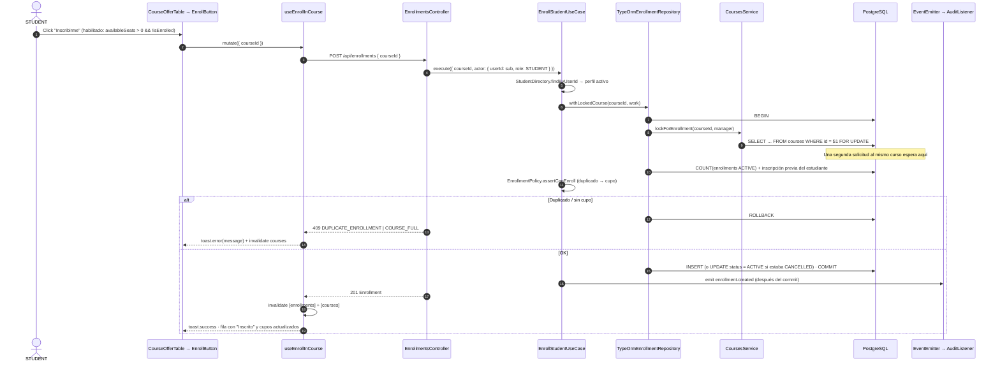
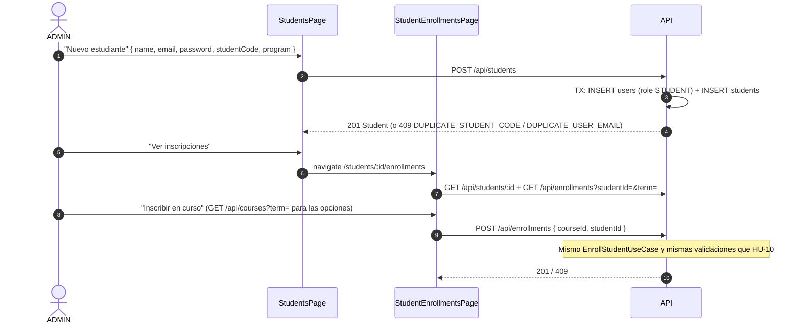

# Plan de Integración (Backend + Frontend) — Épica E3: Estudiantes e Inscripciones

## 1. Documentos del plan E3
Este plan coordina la implementación de punta a punta de la **Épica E3 (HU-09 a HU-13)**. Según `CLAUDE.md`, cada módulo respeta su propio `AGENTS.md` en sus archivos.

1. **Backend:** [e3-backend-students-enrollments-plan.md](./e3-backend-students-enrollments-plan.md), regido por [unicen_backend/AGENTS.md](../../unicen_backend/AGENTS.md).
2. **Frontend:** [e3-frontend-students-enrollments-plan.md](./e3-frontend-students-enrollments-plan.md), regido por [unicen_frontend/AGENTS.md](../../unicen_frontend/AGENTS.md).

**Este documento es la fuente de verdad del contrato HTTP de E3.** Si el backend cambia una forma de respuesta, se actualiza aquí y en `types.ts` del frontend en el mismo PR.

### Punto de partida
| Pieza | Estado |
|---|---|
| Backend E2 (`subjects`, `courses`, tablas `students` y `enrollments`) | ✅ Commit `3b078e8` |
| Frontend E2 (`features/subjects`, `features/courses`) | 🚧 En curso; E3 frontend arranca después de su commit |
| `students`, `enrollments` (backend) | Esqueletos vacíos |
| `estudiantes`, `inscripciones` (frontend) | Carpetas vacías con nombre en español |

---

## 2. Flujos de punta a punta

### 2.1. STUDENT se inscribe (HU-10) y la concurrencia


### 2.2. ADMIN registra e inscribe a un estudiante (HU-09 y HU-11)


### 2.3. Cancelar (HU-13)
`PATCH /api/enrollments/:id/cancel` → propiedad (STUDENT) → `EnrollmentGradesChecker.hasGrades` → `status = CANCELLED` → `enrollment.cancelled`. El front invalida `[enrollments]` y `[courses]`, y el cupo reaparece en la oferta.

---

## 3. Contrato HTTP

Todo usa el prefijo `/api` y `Authorization: Bearer <token>`. Los errores siguen el formato `{ statusCode, error, message, timestamp }` y el front muestra `message`.

### 3.1. Estudiantes (HU-09) — solo ADMIN
| Método | Ruta | Request | Respuesta OK | Errores |
|---|---|---|---|---|
| POST | `/students` | `CreateStudentRequest` | `201 Student` | 400, 409 `DUPLICATE_STUDENT_CODE` / `DUPLICATE_USER_EMAIL` |
| GET | `/students?search=&isActive=` | — | `200 Student[]` | — |
| GET | `/students/:id` | — | `200 Student` | 404 |
| PATCH | `/students/:id` | `UpdateStudentRequest` | `200 Student` | 400, 404, 409 |
| PATCH | `/students/:id/status` | `{ "isActive": false }` | `200 Student` | 404 |

```jsonc
// POST /api/students
{ "name": "Camila Torrez", "email": "camila.torrez@unicen.edu.bo", "password": "Student123!", "studentCode": "S-2026010", "program": "Ingeniería Comercial" }

// 201 Student (nunca passwordHash)
{
  "id": "st-…", "userId": "u-…", "studentCode": "S-2026010", "name": "Camila Torrez",
  "email": "camila.torrez@unicen.edu.bo", "program": "Ingeniería Comercial",
  "isActive": true, "createdAt": "2026-10-27T16:00:00.000Z"
}
```

### 3.2. Inscripciones (HU-10 a HU-13)
| Método | Ruta | Roles | Request | Respuesta OK | Errores |
|---|---|---|---|---|---|
| POST | `/enrollments` | STUDENT | `{ courseId }` | `201 Enrollment` | 403 (`studentId` ajeno), 404 curso / `STUDENT_PROFILE_NOT_FOUND`, 409 `COURSE_FULL` / `DUPLICATE_ENROLLMENT` / `INACTIVE_STUDENT` |
| POST | `/enrollments` | ADMIN | `{ courseId, studentId }` | `201 Enrollment` | 400 `STUDENT_REQUIRED`, 404, 409 (los mismos) |
| GET | `/enrollments/mine?term=` | STUDENT | — | `200 EnrollmentSummary[]` (solo `ACTIVE`) | 400 (term) |
| GET | `/enrollments?studentId=&courseId=&term=&status=` | ADMIN | — | `200 EnrollmentSummary[]` | 400 |
| PATCH | `/enrollments/:id/cancel` | STUDENT (propia), ADMIN | — | `200 Enrollment` | 403, 404, 409 `ENROLLMENT_ALREADY_CANCELLED` / `ENROLLMENT_HAS_GRADES` |

```jsonc
// 201 / 200 Enrollment
{ "id": "en-…", "studentId": "st-…", "courseId": "c-…", "status": "ACTIVE", "enrolledAt": "2026-10-27T16:05:00.000Z" }

// EnrollmentSummary (GET /enrollments/mine y GET /enrollments)
{
  "id": "en-…",
  "status": "ACTIVE",
  "enrolledAt": "2026-10-27T16:05:00.000Z",
  "student": { "id": "st-…", "studentCode": "S-2026001", "name": "Ana Sofía Vargas" },
  "course": {
    "id": "c-…", "term": "2026-2", "section": "A",
    "subject": { "code": "MAT-101", "name": "Cálculo I", "credits": 5 },
    "teacher": { "name": "Dr. Carlos Mendoza" }
  }
}

// 409 sin cupo
{ "statusCode": 409, "error": "COURSE_FULL", "message": "El curso no tiene cupos disponibles", "timestamp": "…" }

// 409 duplicado
{ "statusCode": 409, "error": "DUPLICATE_ENROLLMENT", "message": "Ya estás inscrito en este curso", "timestamp": "…" }
```

### 3.3. Cambios a contratos existentes
| Endpoint | Cambio | Impacto en el front |
|---|---|---|
| `POST /api/users` (E1) | Rechaza `role: STUDENT` con `400` (BD-022) | Quitar `STUDENT` del select de rol si existe ese formulario |
| `GET /api/courses` (E2) | Sin cambios de forma; `enrolledCount` e `isEnrolled` ahora cambian con las inscripciones reales | Invalidar `[courses]` tras inscribir o cancelar |
| `GET /api/courses/:id/enrolled-students` (E2) | Sin cambios; ahora devuelve datos reales | — |

### 3.4. Correspondencia de tipos
| Backend (DTO) | Frontend (`types.ts`) |
|---|---|
| `StudentResponseDto` | `students/types.ts → Student` |
| `CreateStudentDto` / `UpdateStudentDto` | `CreateStudentRequest` / `UpdateStudentRequest` |
| `ListStudentsQueryDto` | `StudentsFilters` |
| `EnrollmentResponseDto` | `enrollments/types.ts → Enrollment` |
| `EnrollmentSummaryResponseDto` | `EnrollmentSummary` |
| `CreateEnrollmentDto` | `CreateEnrollmentRequest` |
| `ListEnrollmentsQueryDto` | `EnrollmentsFilters` |
| `EnrollmentStatus` (domain enum) | `EnrollmentStatus` (const object) |

### 3.5. Validaciones en cada capa
| Regla | Front (UX / forma) | DTO | Dominio / caso de uso | Base de datos |
|---|---|---|---|---|
| Hay cupo | Botón deshabilitado si `availableSeats === 0` | — | ✅ `EnrollmentPolicy` → `CourseFullError` bajo `FOR UPDATE` | — |
| Sin inscripción duplicada | Botón deshabilitado si `isEnrolled` | — | ✅ `DuplicateEnrollmentError` | `UNIQUE (student_id, course_id)` |
| Dos solicitudes al último cupo | — | — | ✅ lock de fila del curso | — |
| El estudiante solo se inscribe a sí mismo | Sin selector de estudiante | `studentId` opcional | ✅ `ForbiddenActionError` | — |
| El estudiante está activo | ADMIN: botón oculto si está inactivo | — | ✅ `InactiveStudentError` | — |
| `studentCode` y `email` únicos | Zod: formato | `@Matches`, `@IsEmail` | ✅ `409` | `UNIQUE` |
| Solo se cancelan las propias | Acción solo en "Mis inscripciones" | — | ✅ `ForbiddenActionError` | — |
| No se cancela con notas | — | — | ✅ `EnrollmentGradesChecker` (E4) | — |

---

## 4. Matriz de roles y rutas de E3

| Funcionalidad | API | SPA | ADMIN | TEACHER | STUDENT |
|---|---|---|---|---|---|
| Gestionar estudiantes | `/students` | `/students` | ✅ | ❌ 403 / `/403` | ❌ 403 / `/403` |
| Inscribirme | `POST /enrollments` | botón en `/courses` | — | ❌ 403 / oculto | ✅ |
| Inscribir a un estudiante | `POST /enrollments` + `studentId` | `/students/:id/enrollments` | ✅ | ❌ | ❌ |
| Mis inscripciones | `GET /enrollments/mine` | `/enrollments` | ❌ 403 | ❌ `/403` | ✅ |
| Inscripciones de un estudiante | `GET /enrollments?studentId=` | `/students/:id/enrollments` | ✅ | ❌ | ❌ |
| Cancelar | `PATCH /enrollments/:id/cancel` | ambas pantallas | ✅ cualquiera | ❌ | ✅ propias |

---

## 5. Orden de ejecución

### Fase 1 — Backend: estudiantes (HU-09)
1. Errores nuevos y su mapeo en `STATUS_BY_CODE`; ajustar el mensaje de `DuplicateEnrollmentError`.
2. `UsersService.create/update` con `manager` opcional; `POST /api/users` rechaza `STUDENT`.
3. DTOs, service, controller y specs de `students`.
   **Commit:** `feat(students): HU-09 register and manage students`.

### Fase 2 — Backend: inscripciones (HU-10 a HU-13)
4. `CoursesService.lockForEnrollment`.
5. `domain/` de `enrollments`: entity, policy, puertos, eventos y `EnrollmentSummary`, con specs de la policy y de la entity.
6. `infrastructure/`: mapper, repositorio (`withLockedCourse`, `findSummaries`), `StudentDirectoryAdapter`, `PendingGradesChecker` y `EnrollmentAuditListener`.
7. `application/`: los 4 casos de uso con sus specs.
8. `presentation/`: DTOs y controller; wiring del módulo.
9. Migración de índices y seed (2 estudiantes más e inscripciones de ejemplo).
10. `npm run lint && npm run build && npm test && npm run test:e2e`, incluido el test de concurrencia.
    **Commits:** uno por HU (ver el plan backend §6).

### Fase 3 — Frontend: preparación (cuando el frontend de E2 esté commiteado)
11. Renombrar `estudiantes` → `students` e `inscripciones` → `enrollments`; mover el manejo de la gestión a `shared/`; crear `QUERY_ROOTS`; instalar `switch` y `tooltip`.
    **Commit:** `refactor(frontend): rename students and enrollments features, share term utils`.

> Mientras el frontend de E2 no esté commiteado, se pueden adelantar los archivos **nuevos** de `students/` y `enrollments/` usando este contrato. No se tocan `features/courses` ni los archivos que se mueven a `shared/`.

### Fase 4 — Frontend: estudiantes (HU-09)
12. `types`, `schema`, `service`, `keys`, hooks, componentes, `StudentsPage` e `index.ts`.

### Fase 5 — Frontend: inscripciones (HU-10 a HU-13)
13. `types`, services, keys y hooks de `enrollments`; `EnrollButton` + `index.ts`.
14. `CourseOfferTable` integra `EnrollButton` (HU-10).
15. `MyEnrollmentsPage` (HU-12 y HU-13) y `StudentEnrollmentsPage` + `AdminEnrollDialog` (HU-11 y HU-13).
16. Router y `nav-items`; `npm run lint && npm run build`.

### Fase 6 — Integración y verificación
17. Correr `docker compose up --build` desde cero, luego el smoke test de §6 y la matriz manual del plan frontend (§6.2).
18. Registrar las decisiones BD-020 a BD-025 y FD-014 a FD-017.
    **Commit:** `docs: record E3 technical decisions`.

---

## 6. Smoke test de la API (después del seed)
```bash
API=http://localhost/api
login() { curl -s -X POST $API/auth/login -H 'Content-Type: application/json' \
  -d "{\"email\":\"$1\",\"password\":\"$2\"}" | jq -r .accessToken; }

ADMIN=$(login admin@unicen.edu.bo Admin123!)
ANA=$(login estudiante@unicen.edu.bo Student123!)
CAMILA=$(login estudiante3@unicen.edu.bo Student123!)

# PRG-101 A (cupo 2, Luis ya inscrito → queda 1 cupo)
PRG=$(curl -s "$API/courses?term=2026-2" -H "Authorization: Bearer $ADMIN" \
  | jq -r '.[] | select(.subject.code=="PRG-101" and .section=="A") | .id')

# HU-10 concurrencia: Ana y Camila compiten por el último cupo → un 201 y un 409
enroll() { curl -s -o /dev/null -w "%{http_code}\n" -X POST $API/enrollments \
  -H "Authorization: Bearer $1" -H 'Content-Type: application/json' -d "{\"courseId\":\"$PRG\"}"; }
enroll "$ANA" & enroll "$CAMILA" & wait

# Cupos tras la carrera → availableSeats = 0
curl -s "$API/courses/$PRG" -H "Authorization: Bearer $ADMIN" | jq '{maxCapacity, enrolledCount, availableSeats}'

# HU-12
curl -s "$API/enrollments/mine?term=2026-2" -H "Authorization: Bearer $ANA" | jq '.[].course.subject.code'

# HU-13: cancelar la primera inscripción de Ana → 200, y repetir → 409
EN=$(curl -s "$API/enrollments/mine?term=2026-2" -H "Authorization: Bearer $ANA" | jq -r '.[0].id')
curl -s -o /dev/null -w '%{http_code}\n' -X PATCH $API/enrollments/$EN/cancel -H "Authorization: Bearer $ANA"
curl -s -o /dev/null -w '%{http_code}\n' -X PATCH $API/enrollments/$EN/cancel -H "Authorization: Bearer $ANA"

# BD-022: no se crean STUDENT vía /users → 400
curl -s -o /dev/null -w '%{http_code}\n' -X POST $API/users -H "Authorization: Bearer $ADMIN" \
  -H 'Content-Type: application/json' -d '{"name":"X","email":"x@unicen.edu.bo","password":"123456","role":"STUDENT"}'
```
Resultados esperados: `201` y `409` (en cualquier orden), `availableSeats: 0`, la lista de códigos de Ana, `200`, `409` y `400`.

---

## 7. Riesgos y puntos a confirmar
| # | Tema | Propuesta | Estado |
|---|---|---|---|
| 1 | La `UNIQUE (student_id, course_id)` impide reinscribirse tras cancelar | Reactivar la fila `CANCELLED` (BD-021) | Propuesto; **confirmar** |
| 2 | HU-13 "no cancelar con notas" sin tabla `grades` | Puerto `EnrollmentGradesChecker` con implementación interina que devuelve `false`; E4 cambia el binding (BD-025) | Propuesto |
| 3 | Estudiante desactivado con inscripciones activas | Se mantienen; solo se bloquean el login y las nuevas inscripciones (BD-023) | Propuesto; **confirmar** |
| 4 | `POST /api/users` con `STUDENT` deja usuarios sin perfil | Rechazar con `400` (BD-022) | Propuesto |
| 5 | El frontend de E2 está en curso y E3 modifica `CourseOfferTable`, `courses.keys` y mueve archivos de gestión | E3 frontend arranca después del commit de E2; antes solo archivos nuevos | Coordinación |
| 6 | Ciclos entre features del front (`courses` ↔ `enrollments`) | API pública por feature y sentido único `courses → enrollments → students` (FD-014) | Propuesto |
| 7 | El mensaje "Ya estás inscrito" se lee raro cuando lo ve el ADMIN | Aceptable por ahora (texto de `tasks.md`); opcionalmente el caso de uso elige el mensaje según `actor.role` | Menor |

---

## 8. Definición de terminado de E3
- [ ] HU-09 a HU-13 cumplen los criterios de [docs/tasks.md](../tasks.md); HU-10 incluye el test e2e de concurrencia.
- [ ] Tests unitarios obligatorios: `EnrollStudentUseCase` (cupo lleno, duplicado, éxito y demás errores), `CancelEnrollmentUseCase` y `EnrollmentPolicy`.
- [ ] Se emite `enrollment.created` y se ve en los logs del contenedor `api` (`[audit] enrollment.created …`).
- [ ] Backend: `lint`, `build`, `test` y `test:e2e` en verde; `domain/` sin imports de framework.
- [ ] Frontend: `lint` y `build` en verde; imports entre features solo por `index.ts` y sin ciclos.
- [ ] El contrato de §3 coincide con los DTOs y con los `types.ts`.
- [ ] `docker compose up --build` desde cero deja E3 funcional con los datos del seed.
- [ ] Decisiones registradas y commits por historia.
